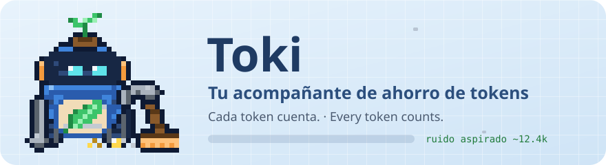

<p align="center">
  
</p>

# Toki: tu acompañante de ahorro de tokens

**Cada token cuenta.** Toki es un robot de limpieza que vive sobre tu prompt en Claude Code: aspira el ruido para que Claude lea solo lo que importa. Lo instalas una vez y se encarga solo: compacta las salidas ruidosas, rescata los errores que se esconden, recuerda lo importante cuando Claude Code compacta, mapea tu proyecto y te avisa justo cuando conviene actuar. Toma las mejores ideas de las herramientas de ahorro más populares, las combina sin que se pisen y nunca sacrifica calidad para ahorrar.

Habla español e inglés. Lo único fijo que agrega a tu contexto, en el caché, son ~200 tokens para pedir respuestas breves (lo que cuestan se resta de lo que ahorran); sus comandos no ocupan contexto.

> Versión 0.17.6. Requiere Claude Code 2.1.287 o posterior. [English below](#english).

## Instalación

En una sesión de Claude Code:

```
/plugin install toki --marketplace DMercadoCanas/toki
```

Responde `y` para agregar el marketplace y elige el alcance (Enter para "usuario"). Queda activo de inmediato. Desde la terminal del sistema es lo mismo con `claude plugin install toki --marketplace DMercadoCanas/toki`. En la app de escritorio: botón **+** junto al cuadro de texto → **Plugins** → **Add marketplace** con `DMercadoCanas/toki` → **Add plugin**.

## Lo nuevo en 0.17

- **El ahorro, medido y en dólares.** Antes la barra tenía tres cifras, y la primera, «ahorrado», solo contaba las salidas recortadas: en una sesión sin tests ni builds se quedaba en ~0 aunque Toki ahorrara por otro lado. Ahora hay una sola cifra, lo ahorrado en la sesión a precio de API, con cuánto menos costó que sin Toki («ahorrado $0.42 −18 %»). Suma todo lo que ahorra:
  - **Modelo y esfuerzo:** cada pedido se compara con el mismo pedido sin Toki (tu modelo, tu esfuerzo y el caché que tu modelo habría tenido), con lo que devolvió la API. Lo que costó de más (reescribir el caché al cambiar de modelo, más esfuerzo, la consulta a Haiku) se resta. Si en neto costó de más, la barra lo dice.
  - **Relecturas evitadas y salidas recortadas**, ahora también en dólares.
  - **Empezar en limpio:** si Toki lo propone y dices que sí, la conversación de antes deja de releerse en cada pedido. Cuenta hasta que esa conversación habría llegado al 80 % de la ventana, hasta que compactes o hasta que termine la sesión.
  - **Respuestas breves** (abajo).
  - `/toki` desglosa de dónde sale cada dólar y dice «esta sesión costó X; sin Toki habría costado Y». La tarjeta semanal y el aviso del lunes traen la cifra neta y la comparación con la semana anterior. Con suscripción no lo pagas aparte: es uso de tus límites que te queda libre.
  - Lo ahorrado antes de 0.17 (solo tokens) se pasa a dólares una sola vez, a precio de Sonnet, y el panel dice cuánto fue estimado.
- **Respuestas breves desde el primer mensaje.** Una sección fija al final del system prompt (~200 tokens, en el caché) le pide a Claude respuestas sin relleno; el código, los comandos, los errores y las rutas no se tocan. Medido sin Toki en Opus 5.5: ~12 % menos salida en tareas de código y 15-18 % en preguntas abiertas, con los tests pasando igual; lo mismo que el estilo Concise de Claude Code, que pesa más del doble ([evals/modo-breve](evals/modo-breve)). El ahorro se cuenta con el 12 %, en tu modelo y con tu esfuerzo, menos lo que cuesta mandar la sección. Si eliges tu propio `/output-style`, se respeta; se apaga en `/plugin` → Toki → Respuestas breves.
- **La entrevista se cumple.** En un pedido grande con entrevista, hasta que Claude te pregunte, Toki frena (y le dice por qué) las herramientas que cambian algo y los subagentes; leer para preparar las preguntas sí pasa. A lo sumo 3 veces por mensaje: nunca un bucle. «Con» o «sin entrevista» se cuenta al terminar, según Claude haya preguntado de verdad; si lo interrumpes antes de que pregunte, no cuenta. Las preguntas de Toki no cuentan como las de Claude.
- **Investigar no se entrevista.** «¿Por qué falla…?» va directo: Claude investiga primero. Y «esto hay que solucionarlo…» retoma lo anterior, así que Toki no ofrece empezar en limpio aunque parezca otro tema.
- El chip del modelo lleva ✓ cuando la API confirma qué modelo respondió.
- **0.17.1: el esfuerzo de verdad.** Toki suponía esfuerzo «medio» al abrir la sesión y no se enteraba de `/effort`: si ibas en «muy alto», planeaba como si fueras en medio y no bajaba nada. Ahora, antes de cada mensaje, lo lee como Claude Code: `CLAUDE_CODE_EFFORT_LEVEL`, lo que `/effort` guardó en tu configuración o en la del proyecto, y el por defecto de cada modelo. `/effort` (también `max`) cuenta desde el mensaje siguiente. Si aun así el primer pedido trae otro, Toki decide de nuevo antes de que salga y sin preguntar: aplica lo que ahorra, no sube lo que cuesta más y respeta lo que elegiste en la pregunta. Si tu cuenta trae otro por defecto que el de fábrica, lo recuerda para la próxima sesión. El diagnóstico lo anota como `ruta corregida`. Y si otro hook frena tu mensaje, lo que Toki planeó para él ya no pasa al siguiente.
- **0.17.2: Toki pasa la aspiradora.** El Toki en píxeles dejó la escoba: ahora trabaja con una aspiradora de manguera anillada que chupa los tokens del suelo, y tiene manos de garra de dos pinzas.
- **0.17.3: la barra muestra a cuánto compacta.** Al cambiar de modelo, la barra podía saltar a «de 1.0M» aunque Claude Code siguiera compactando a los 300k. Ahora muestra siempre la ventana a la que de verdad se compacta.
- **0.17.4: bajar el esfuerzo con cuidado, y un ahorro más honesto.** Una orden corta que cambia código («agrega el campo cups») ya no va en esfuerzo bajo. Si un mensaje que Toki bajó pasa de 8 pedidos o entra en bucle, vuelve a tu esfuerzo a mitad del turno, y una corrección («no, eso no») nunca cuenta como simple. Lo que ahorra bajar el esfuerzo se cuenta a la mitad de la tabla hasta tener datos: 1 de cada 10 mensajes que Toki bajaría va con tu esfuerzo, de testigo, y `/toki-modelo` muestra lo medido. Si las respuestas breves no pueden ir en el system prompt, Toki se lo pide a Claude con una nota y te sugiere una vez `/output-style` → `toki:conciso`. En la app de escritorio, el robot y el texto de la barra van lado a lado.
- **0.17.5: planear en Opus, ejecutar en Sonnet, y `/toki-dieta`.** Cuando Claude cierra un plan o guarda el spec de la entrevista, Toki ofrece una vez seguir en Sonnet, que cuesta la mitad; sube a Opus si algo falla. `/toki-dieta` muestra cuánto pesa el contexto fijo en cada pedido (memoria, skills, agentes, servidores MCP), cuánto cuesta con el caché vivo y vencido, y sugiere apagar en `/mcp` los servidores que no usaste en 7 días. La tarjeta semanal dice cuántas tareas hiciste, ~$ por tarea y correcciones por tarea. En la app de escritorio, la barra lleva a Toki dentro de un anillo que marca el contexto, sin borde. «Compactar ahora» ya no falla en silencio: si un hook lo veta (por ejemplo, una política de la empresa) o Claude está en un turno, te lo dice y deja `/compact` listo en el cuadro.
- **0.17.6: el mapa entiende tu framework, MCP más liviano y exploración en subagentes.** El mapa del proyecto suma, si reconoce el framework, dónde se define y se hereda cada modelo: en Odoo (módulos con sus `depends`, `_name`/`_inherit` y vistas) y en Django (modelos y URLs con nombre). Las salidas largas de texto de MCP se compactan como las de la terminal, con el original guardado; JSON, imágenes y errores van enteros. Si Claude hace muchas búsquedas y lecturas grandes en un turno, Toki le sugiere una vez seguir con un subagente Explore, más barato.
- **¿Quedó bien?** De vez en cuando, después de un mensaje que Toki bajó solo de modelo o esfuerzo, o de un testigo que dejó con el tuyo para comparar, Toki te pregunta si la respuesta quedó bien. Es la misma pregunta en los dos casos, sale después de que lees la respuesta y no gasta tokens: pregunta Toki, no Claude. Pregunta por 1 de cada 10 mensajes bajados y por cada testigo, nunca dos veces en menos de 30 minutos, y deja de preguntar por un grupo cuando junta 30 respuestas. También cuenta, sin preguntar, cuántas veces tu mensaje siguiente corrigió el anterior («no era eso»). `/toki-modelo` compara los dos grupos; «No preguntes más» la apaga y `/toki-modelo calidad` la vuelve a activar. Lo que bajaste tú, al responderle a Toki o con el modo ahorro, no cuenta: no tiene testigos con qué compararlo. Solo se guardan cuentas, nunca tu texto, y no salen de tu máquina.
- **El rescate del `| tail` ya no pide permisos.** Toki guardaba la copia completa envolviendo el comando con `tee`, y con permisos normales Claude Code lo veía como un comando nuevo: Toki lo dejaba pasar sin rescate. Ahora agranda el mismo corte (`| tail -n 40` pasa a `| tail -n 10000`: el mismo programa de solo lectura, con el mismo permiso) y corta él mismo: Claude ve las mismas líneas que pidió, más los errores que el corte escondía. Las salidas largas las lee del archivo donde Claude Code las guarda, sin envolver nada.
- **Eval completa en Opus y Sonnet.** `bash evals/correr.sh` corre los 11 casos con y sin Toki, 5 veces por brazo, y reporta aprobadas, costo por tarea exitosa e intervalos de 95 %. Lo que Toki gana y lo que cuesta está en [Resultados medidos](#resultados-medidos-con-y-sin-toki).
- **Guardia de empresa.** En las cuentas Team y Enterprise, Claude Code corre un guardia que se salta algunos hooks de Toki, y por cada uno le deja a Claude un aviso de ~215 tokens, otra vez tras cada compactación. Esos avisos eran casi todo lo que Toki costaba de más en la eval (de 1 % a 4 %), no sus comandos. Con la opción nueva, Toki no registra esos hooks: la prende solo al notar el guardia y la apaga cada 30 días para ver si sigue. Con ella, la nota de respuestas breves va desde tu primer mensaje, y Toki sugiere una vez `/output-style` → `Concise`, el estilo de Claude Code: medido, baja la salida tanto como la sección de Toki, y la nota mucho menos. Detalles en [Configuración](#configuración).
- **Lo que se volvió a escribir en el caché, y por qué.** Cuando un pedido vuelve a escribir lo que ya estaba en el caché, paga escribirlo en vez de leerlo: 30k tokens en Opus cuestan ~$0.14 de más con el caché de 5 min y ~$0.23 con el de 1 h. Claude Code no les dice a los plugins por qué pasó (`/usage` sí), así que Toki lo deduce del pedido anterior: una pausa más larga que el plazo del caché (también al reanudar una sesión), un cambio de modelo, un cambio de esfuerzo, compactar u otro cambio. `/toki` muestra cuánto se reescribió en la sesión y lo que costó de más por causa; la tarjeta de `/toki-semana`, lo mismo en la semana, y el diagnóstico anota cada vez. Se calcula en tu máquina con lo que devolvió la API y no agrega nada al contexto. Donde cambiar el esfuerzo vacía el caché (en Bedrock o detrás de un gateway, por ejemplo), Toki deja de cambiarlo por el resto de la sesión, y si el cambio fue suyo, lo que costó de más se descuenta de su ahorro.
- **`/toki-dieta` arregla, con tu permiso y de forma reversible.** Además de mostrar lo que pesa cada pedido, ahora lo arregla:
  - **MCP sin uso, bajo demanda.** Un servidor MCP que no usaste en 7 días y que va entero en cada pedido (por ejemplo, con `alwaysLoad`) queda tras ToolSearch: deja de ir en cada pedido y Claude lo carga si lo busca. Toki no toca tu configuración de MCP: guarda la lista en su opción **MCP bajo demanda** y lo hace con un hook. Solo lo ofrece si Claude Code ya deja herramientas tras ToolSearch en la sesión, y no con **Guardia de empresa** prendida. El mensaje siguiente reescribe el caché una vez, y Toki dice cuánto cuesta.
  - **Memoria larga.** Un CLAUDE.md de más de 200 líneas pesa en cada pedido, y de un MEMORY.md de más de 200 líneas o 25 KB Claude Code solo carga el comienzo. Toki guarda un respaldo en `.claude/toki/respaldos/` y te deja en el cuadro de texto un pedido para que Claude lo adelgace, mostrándote cada cambio. El pedido no nombra ningún proyecto ni stack: Claude lo adapta a lo que encuentre. Toki no edita tu memoria. Si tienes suscripción, te recuerda que `/usage` (tecla f) también lo arregla.
  - **Skills sin uso.** Toki anota qué skills usas (las que llama Claude y las de `/nombre`) y, tras 7 días, nombra las que no usaste si pesan: las tuyas se dejan solo con su nombre o se apagan en `/skills`, y un plugin con todas sus skills sin usar se desactiva en `/plugin`. Ahí Claude Code ya tiene sus menús: Toki te dice qué tocar.
  - Después del informe, si hay MCP o memoria que arreglar y alguien mirando, Toki pregunta qué arreglar. `/toki-dieta mcp` y `/toki-dieta memoria` lo hacen directo; `/toki-dieta restaurar` vuelve a cargar los MCP y te da el comando para volver a cada respaldo. Lo que esto ahorra no se suma a la cifra de Toki: Toki solo suma lo que mide.

- **Preguntas justo a tiempo.** Cuando una respuesta tuya cambia lo que Claude hace, Toki pregunta con el diálogo de Claude Code (no gasta tokens) en vez de darte un consejo: una sola pregunta por mensaje, la opción recomendada primero, y siempre puedes escribir la tuya.
  - **Dónde buscar.** En una tarea nueva que pide cambiar o averiguar algo sin decir dónde, con las carpetas de tu proyecto que más pesan (primero las que nombras). Fuera de un proyecto, o con menos de 3 carpetas, no pregunta: buscar sale barato.
  - **Cómo sabremos que quedó.** En un cambio que no dice cómo comprobarlo, con lo que tu proyecto ya sabe correr: sus scripts de test, lint o build, `make test`, `pytest`, `cargo test`, `go test`… Toki lo lee de los archivos de la raíz y no inventa nada; si no hay qué correr, queda el consejo de siempre. Claude lo comprueba antes de terminar, y el criterio pasa a la compactación.
  - **Cómo seguir tras dos correcciones.** Las buenas prácticas de Claude Code piden `/clear` cuando corriges lo mismo dos veces. Toki pregunta si empezar en limpio con un pedido que junta tus correcciones (primero cuando la conversación pasa de 60k), que Claude busque la causa antes de otro intento, o seguir. Antes solo lo ofrecía con mucho contexto.
  - **Separar tareas.** Un mensaje con 3 tareas o más en lista, cada una con su verbo: ¿una por una? Va la primera, y al terminar cada una Toki deja la siguiente en el cuadro, con lo que iba antes y después de la lista. Si mandas otra cosa dos veces, deja la lista. Una lista de requisitos de una sola cosa no se parte.
  - **Qué no olvidar al compactar.** Con un `/compact` sin instrucciones, con el botón de la barra o al llegar al 85 % de donde Claude Code compacta (una vez por tramo): tus reglas al pie de la letra, lo que ya se probó y no funcionó, o lo que escribas. Lo que eliges va a ese resumen; lo que escribes queda en la memoria de Toki hasta `/clear`.
  - **El spec como `/goal`.** La entrevista ahora deja en `.claude/toki/spec.md` una línea «Listo cuando: …». Si Claude lo guarda y termina el turno sin preguntarte nada, Toki ofrece ponerla como `/goal`: Claude Code la revisa cada vez que Claude va a detenerse y lo hace seguir hasta que se cumpla. Si escribes tu propia condición, queda en el cuadro para que la revises. No con **Guardia de empresa**.
  - Dos «no» seguidos (cerrar la pregunta también cuenta) y esa pregunta se calla; Toki te lo dice. `/toki-entrevista` muestra cuáles están calladas y `/toki-entrevista auto` las devuelve. Con `no`, con `claude -p` o sin nadie mirando, no pregunta. Una pregunta reemplaza al consejo del mismo tema: si Toki ya preguntó dónde buscar, no te aconseja nombrar el archivo.

- **La compactación aprende.** Si Claude abre la copia completa de una salida que Toki compactó, es que le faltó algo: la próxima vez Toki compacta esa familia de comandos (el programa y su subcomando, como `npm test` o `cargo build`; en MCP, la herramienta) con el triple de contexto al principio, al final y alrededor de cada error. Si aun así Claude lee más de la mitad de la copia dos veces, esa familia va entera un mes. Tras 15 compactaciones seguidas sin que Claude abra la copia, vuelve a compactarse como siempre. Toki te avisa cuando aprende algo, y lo aprendido vale en todos tus proyectos.
  - **Oportunidades perdidas.** Toki compacta los comandos que reconoce como ruidosos: tests, builds, instalaciones, linters, logs. Cuando otro comando da una salida larga, anota cuánto habría ahorrado compactarla, sin guardar el comando ni la salida: solo la familia. `/toki-por-que` lista las que se repitieron en los últimos 30 días (2 veces o más, ~2k tokens o más en total) y, si hay alguien mirando, pregunta si compactarlas también; las que eliges quedan en la opción **Compactar también**.
  - `/toki-por-que olvidar [familia]` borra lo aprendido de esa familia y, si la agregaste, deja de compactarla. Sin familia, olvida todo lo aprendido y anotado, pero no toca **Compactar también**.

- **Caché de 1 hora para tus subagentes, si paga.** Claude Code les da a los subagentes el caché de 5 minutos: si uno vuelve tras una pausa de 5 a 60 minutos, o se lanza otro del mismo tipo en ese rato, reescribe lo que con 1 hora habría leído. A cambio, con 1 hora cada escritura cuesta 2× la entrada en vez de 1.25×. Toki mide las dos cosas en cada pedido de subagente y, con 200 pedidos en 30 días y un ahorro de al menos 1.15× lo que cuesta de más, te avisa una vez.
  - `/toki-dieta` muestra lo medido y, si conviene, pregunta si la pone; `/toki-dieta subagentes` lo hace directo. Vale para todas tus sesiones con Toki: la pone al empezar cada una.
  - Toki la sigue midiendo. Si a los 14 días, con 200 pedidos medidos, costó más de lo que ahorró, la vuelve a 5 minutos y te lo dice. `/toki-dieta restaurar` la quita cuando quieras.
  - Lo que ahorra, y lo que cuesta de más, entra en la cifra de Toki pedido a pedido.
  - Si la fijas tú (el ajuste `subagentPromptCacheTtl` o una variable de caché de Claude Code), Toki no la toca. Tampoco en Bedrock, Vertex o Foundry, ni antes de Claude Code 2.1.243.

- **¿Te sirve cada ayuda? Los testigos lo miden.** Como ya hacía con el esfuerzo, Toki deja algunas tareas sin una de sus ayudas, de testigo: 1 de cada 10 sin compactar salidas, y 1 de cada 4 sin frenar archivos generados, sin la nota del mapa, sin el aviso de delegar a Explore, sin la entrevista antes de pedidos grandes o sin guardar scripts repetidos. Una tarea empieza con un pedido nuevo tuyo, de 8 palabras o más (no una corrección ni un seguimiento de lo anterior), y termina con el siguiente, con `/clear` o al cerrar la sesión. Desde que la ayuda pudo actuar hasta ahí, Toki suma lo que costó la tarea (con sus subagentes) y cuántas veces corregiste a Claude, con la ayuda y sin ella.
  - `/toki-por-que` lo muestra por ayuda. Desde 10 testigos dice cuánto ahorra o cuesta cada una por tarea, con su intervalo de 95 %, o que aún no se nota la diferencia.
  - Con 30 testigos la ronda cierra (en compactar hacen falta unas 300 tareas en que pueda actuar; en las demás, unas 120) y Toki deja de apartar tareas. Si con la ayuda las tareas salieron claramente más caras, o tuviste que corregir claramente más, Toki la pausa y te lo dice; `/toki-por-que reanudar` la vuelve a usar. A los 90 días, Toki vuelve a medir.
  - Un testigo pierde solo la ayuda que se mide: las salidas repetidas, el rescate del `| tail` y el detector de bucles siguen. Todo se calcula en tu máquina.

- **Los scripts que se repiten, en un archivo.** Si Claude corre igual por segunda vez un comando largo (300 caracteres o más: un heredoc, un `python -c`, un pipeline), Toki lo guarda tal cual en `.claude/toki/scripts/` y le dice a Claude que lo repita con `source` y esa ruta en vez de escribirlo entero: repetirlo deja de costar el comando completo en tokens de salida. Con `source` corre en el mismo shell, con el mismo efecto.
  - Solo si Claude Code le da a `source` el mismo permiso que al comando; si no, Toki no guarda nada. Un comando que parece llevar una credencial (una clave, un token, una contraseña) nunca llega al disco.
  - Una vez por comando hasta la próxima compactación, y 5 como mucho por conversación. Si ya hay un archivo con ese nombre y otro contenido, no lo toca. El diagnóstico anota cuándo Claude lo usó, con los tokens que se ahorró, y cuándo lo volvió a escribir entero.
  - Se apaga con **Guardar scripts repetidos** en la configuración.

## Lo nuevo en 0.16

- **Nota de la semana.** La tarjeta de `/toki-semana` trae ahora una nota de A a F con tres partes, cada una con su porqué. El consejo del final apunta a la parte más floja.
  - **Contexto** (la mitad de la nota): cuántos pedidos pasaron de 150k de contexto.
  - **Claridad**: cuántos de tus mensajes corregían lo anterior («no, eso no…»). Cuenta desde 10 mensajes.
  - **Caché**: cuántas veces volviste con el caché vencido y mucho contexto.
  - La nota aparece desde 20 pedidos y 5 mensajes tuyos en la semana.
- **Más cifras en la tarjeta:**
  - cuánto ahorró elegir modelo y esfuerzo por mensaje (a precio de API; con suscripción es límite que no gastas);
  - cuántos de tus mensajes respondió cada modelo;
  - las correcciones por pedido con y sin preguntas antes;
  - cuántos consejos para pedir mejor te dio Toki.
  - Si casi todo fue a Opus, el consejo sugiere `/toki-sonnet sí`.
- **`/toki-semana md`** guarda la tarjeta en Markdown en `.claude/toki/semana-AAAA-MM-DD.md`, lista para pegar en un documento o mandar al equipo. La carpeta se ignora sola en git. Con la semana anterior: `/toki-semana pasada md`.
- **El aviso del lunes** lleva la nota y dice cómo ver la tarjeta: `/toki-semana pasada`.
- **0.16.1: palabras con tilde y ñ.** Toki leía mal algunas: «no funcionó» no contaba como que seguías atascado (y el mensaje podía ir a un modelo más barato justo ahí), «área» contaba como pedir que pensara a fondo y «un pequeño sistema» no contaba como proyecto nuevo. Ahora reconoce cualquier letra. Y `/toki-sonnet actívalo` o `apágalo`, como dice su ayuda, ya funcionan.
- **0.16.2: un registro para afinar a Toki.** `.claude/toki/diagnostico.txt` ahora sigue entre sesiones (las últimas 1000 líneas, varios días de uso). Anota cada decisión de modelo y esfuerzo, lo que deshiciste, qué mensajes corregían el anterior y, de cada mensaje, lo que gastó de verdad junto a lo que Toki estimó. Nunca guarda el texto de tus mensajes: solo el tipo de mensaje, el porqué, el cambio y las cifras. Sirve para ajustar los umbrales con uso real. Queda en la carpeta del proyecto, que git ignora sola.
- **0.16.2: lo que se midió en una sesión real.** En un mensaje simple, bajar el esfuerzo de medio a bajo no ahorra: la respuesta sale del mismo tamaño. Toki ya no lo cambia ni lo cuenta como ahorro; `/toki-modelo` dice «sin cambio (casi no cambia el costo)». Lo que más pesa es cuántas veces se relee el contexto: cada vez que Claude usa una herramienta. Además, un «gracias» después de pensar a fondo ya no hereda lo profundo ni cambia de modelo. Y cuando Toki no puede preguntar (`claude -p`, o porque lo callaste) y lo recomendado reescribiría el caché, al menos baja el esfuerzo en tu modelo, si eso ahorra.

## Lo nuevo en 0.15

- **Solo Sonnet hasta que haga falta.** Actívalo con `/toki-sonnet sí` o en la configuración. Toki trabaja en Sonnet, que cuesta la mitad que Opus, y sube a Opus solo cuando hace falta: cuando pides pensarlo a fondo («ultrathink», «analiza a fondo…») o cuando algo sigue fallando. Cuando vuelves a algo normal, vuelve a Sonnet.
  - Cambia de modelo cuando sale gratis (al empezar, o con el caché vencido) o cuando el cambio se paga en los próximos mensajes; con un caché grande y caliente, espera.
  - Subir a Opus cuesta más: en modo `preguntar`, Toki te pregunta antes. Volver a Sonnet ahorra, así que lo hace solo y lo avisa.
  - Los subagentes generales también van en Sonnet, salvo los que piden pensar a fondo o retoman algo que falló. Con Fable u otro modelo, Toki solo ajusta el esfuerzo.
  - `/toki-sonnet` muestra si está activo y cuántos mensajes fueron en cada modelo en la sesión.
- **Si eliges modelo con `/model`, manda tu elección.** Si eliges Opus, Sonnet primero queda en pausa por la sesión; `/toki-sonnet sí` lo reanuda.
- **`/toki-modelo deshacer`** vuelve atrás el último cambio de modelo o esfuerzo, igual que el botón Deshacer, y Toki no lo repite solo en la sesión para mensajes del mismo tipo.
- **El ahorro por modelo cuenta cada mensaje.** Antes contaba solo el mensaje en que Toki cambiaba de modelo. Ahora cuenta también los que siguen en el modelo más barato, contra lo que costaría cada uno sin Toki (tu modelo, con tu esfuerzo).

## Lo nuevo en 0.14

- **Preguntas antes de un pedido grande.** Si empiezas algo nuevo y amplio («quiero una app para…», «diseña la arquitectura de…») sin decir archivos ni cuándo está listo, Toki le pide a Claude que te haga 2-4 preguntas de opción múltiple (la recomendada primero) y deje el resumen en `.claude/toki/spec.md`. Cuesta ~1-2k tokens y evita correcciones. No pregunta en seguimientos, pedidos ya detallados, comandos ni con `claude -p`. Escribe «sin preguntas» para saltarla; tras 3 saltos Toki se calla. `/toki-entrevista auto|preguntar|no`; sin argumento muestra cuántas correcciones hubo con y sin entrevista.
- **Consejos para pedir mejor.** Un aviso corto (una vez por tipo, máximo 2 veces): comprobar el resultado, nombrar el archivo, separar tareas mezcladas, acotar un «todo».
- **Empezar en limpio.** Tras dos correcciones sobre lo mismo, o un cambio de tema con mucho contexto, Toki ofrece limpiar y te devuelve el mensaje (con lo que ya probaste, si fue una corrección).

## Lo nuevo en 0.13

**Tarjeta semanal.** El primer lunes que abres Claude Code, Toki te avisa que la semana anterior ya está lista. Con `/toki-semana` ves la semana en curso; con `/toki-semana pasada`, la anterior. La tarjeta muestra cuánto ahorró por tipo (salidas compactadas, salidas repetidas, búsquedas, textos pegados), cómo te fue contra la semana previa, relecturas evitadas, lecturas frenadas, tokens leídos, pedidos y sesiones, tu mejor día y tu racha. El costo solo aparece si pagas por token. Cierra con un consejo según tu semana: por ejemplo, si muchos pedidos fueron con contexto largo, usa `/clear` o `/compact` entre tareas.

**Presupuesto por tarea.** `/toki-presupuesto $2` o `/toki-presupuesto 500k` pone un tope a lo que estás haciendo. Toki avisa al 50 % y al 80 % (y la barra muestra `tope 80%`). Si pasas el tope, antes de tu próximo mensaje te pregunta qué hacer:

- seguir en modo ahorro (modelo y esfuerzo más baratos hasta que termine la tarea);
- subir el tope un 50 %;
- parar, con tu mensaje de vuelta en el cuadro;
- quitar el tope.

El tope se borra con `/clear` o con `/toki-presupuesto quitar`. Con suscripción, en tokens es más fiel que en dólares.

**Benchmark con la herramienta oficial.** `evals/` tiene ahora siete casos para `claude plugin eval`, y `evals/benchmark.py` convierte el resultado en una tabla de nota y costo con y sin Toki (ver [Resultados medidos](#resultados-medidos-con-y-sin-toki)).

## Lo nuevo en 0.12

**0.12.1: archivos generados, por tramos.** En una prueba en vivo, cuando Toki frenaba la lectura de un `package-lock.json`, Claude la repetía enseguida y se llevaba el archivo entero. Ahora la segunda lectura trae solo las primeras 300 líneas y la tercera, el archivo completo. Con el cambio, Claude pasó a leer por tramos: 2–16 KB en vez de 35 KB.

**Búsquedas enormes.** Si Claude corre por la terminal un `grep -r`, `rg`, `git grep`, `find` o `fd` sin filtrar y la salida pasa de 30 KB, Claude Code la corta a ciegas. Toki entrega en su lugar un resumen: coincidencias por archivo (o rutas por carpeta), las primeras coincidencias de los archivos con más, y la ruta de la salida completa para que Claude busque ahí. Probado con `claude -p`: un `grep -rn` de 254 KB (1.800 líneas en 60 archivos) llegó como un resumen de ~3k tokens y Claude respondió bien. Se apaga con la opción "Resumir búsquedas enormes".

## Lo nuevo en 0.11

**Textos pegados enormes.** Todo lo que pegas en el chat (un log, un JSON, un archivo entero) se queda en la conversación y Claude lo relee en cada mensaje que sigue: un log de ~15k tokens en una conversación de 30 mensajes son ~450k tokens releídos. Si pegas más de ~10k tokens, Toki pregunta antes de enviar:

- **Guardar en archivo y enviar lo esencial ★**: guarda el texto completo en `.claude/toki/pegados/` y a Claude le llega el principio (donde suele ir tu pregunta), el final (donde suele estar el error), las líneas con error del medio y la ruta de la copia. Claude lee el resto con Grep o por tramos si lo necesita.
- **Enviar completo**: tal cual. Si lo eliges dos veces, Toki no vuelve a preguntar en la sesión.

Se apaga con la opción "Textos pegados enormes". En `claude -p` no pregunta ni toca nada.

## Lo nuevo en 0.10

**Frena la lectura de archivos generados.** Si Claude intenta leer entero un lockfile (`package-lock.json`, `yarn.lock`, `Cargo.lock`…), código minificado, un `.map`, código generado (`.g.dart`, `.pb.go`…) o algo dentro de `node_modules`/`dist`, Toki lo detiene la primera vez y le sugiere buscar con Grep o leer un tramo con `offset` y `limit`. Si Claude insiste con la misma lectura, se la entrega: nunca te quedas sin el archivo. Se apaga con la opción "Frenar lecturas de archivos generados".

## Lo nuevo en 0.9

- **Aviso de caché vencido antes de enviar.** El caché dura 1 hora con una suscripción y 5 minutos en la API. Si vuelves después y la conversación pesa más de 60k tokens, tu próximo mensaje reescribe todo el contexto a precio de escritura, entre 25 y 40 veces lo que cuesta releerlo. Por eso Toki te pregunta antes de enviar y te muestra el costo: con 220k en Opus y una suscripción, «cuenta como ~5 mensajes normales de tu límite»; en la API, «≈$1.06 más que con el caché vivo». Las opciones:
  - **Compactar y enviar:** Toki compacta con su memoria de la tarea y reenvía tu mensaje solo. Después, cada mensaje sale ~30-50% más barato. Desde 120k tokens es la recomendada (★).
  - **Enviar así:** con menos de 120k es la recomendada. Si la eliges dos veces, Toki no vuelve a preguntar en esa sesión.
  - **Empezar en limpio:** Toki hace `/clear` y te devuelve el mensaje al cuadro, con una nota de la tarea, las decisiones y los archivos de antes. Lo revisas y lo envías.
- **Guardia de límites (planes con suscripción).** Toki calcula a tu ritmo de gasto cuándo se acaba la ventana de 5 horas y la semanal. En la de 5 horas usa tu ritmo de los últimos 45 minutos, si lo hay.
  - Si se acaba antes de renovarse, avisa una sola vez por ventana: desde el 50% en la de 5 horas y desde el 30% en la semanal. La barra lo muestra: `5 h 72% se acaba ~3:40 p. m.`.
  - Al 90%, antes de enviar, pregunta una vez: **Modo ahorro hasta que se renueve**, **Seguir igual** o **Esperar**, que deja tu mensaje en el cuadro.
  - En modo ahorro, cada mensaje va con la opción Ahorro sin preguntar: Sonnet si el contexto es chico y menos esfuerzo. `/toki-modelo preguntar` lo quita.
- **Se pueden apagar:** **Avisar si el caché venció** y **Vigilar tus límites**, en la configuración. En `claude -p` y en el SDK nunca preguntan.

## Lo nuevo en 0.8

- **Modelo y esfuerzo para cada mensaje.** Antes de enviar tu mensaje, Toki lo lee y lo clasifica: trivial, normal, complejo o profundo. Usa reglas rápidas y, si duda, una consulta corta a Haiku que dura como máximo 2 segundos. Luego elige el modelo y el esfuerzo de ese mensaje:
  - Un "renombra foo a bar" va con Sonnet y esfuerzo bajo.
  - Un "ultrathink: analiza a fondo…" va con Opus y esfuerzo máximo.
  - Si te trabas ("sigue fallando", "no funciona"), sube un nivel.
- **Te muestra las opciones con sus consecuencias.** Hasta tres opciones, Calidad, Equilibrio y Ahorro, más **Dejar como está**. Cada una muestra su modelo y esfuerzo, cuánto cuesta frente a lo que tienes (`+40%`, `−65%`) y, si cambia el modelo, cuánto caché se reescribe. La recomendada lleva ★.
- **Cuándo pregunta y cuándo cambia solo.** Por defecto pregunta solo si la opción cuesta más o si cambiar el modelo reescribiría más de 30k tokens de caché. Si la opción ahorra, la aplica sola.
- **Te avisa cuando cambia algo.** Si Toki cambia algo, la barra parpadea, suena una campanita y aparece "⚡ Este mensaje va con Sonnet · esfuerzo bajo". El botón **Deshacer** vuelve a lo de antes.
- **Respeta tus decisiones.** Si eliges "Dejar como está", Toki recuerda tu elección para ese tipo de mensaje. Si la eliges 3 veces, deja de preguntar en esa sesión.
- **Cambia entre Opus y Sonnet solo cuando conviene.** Cambiar de modelo obliga a reescribir el caché una vez. Toki solo cambia cuando la conversación es chica o el caché ya está frío (sesión nueva, después de `/clear` o de compactar, o caché vencido). Cambiar el esfuerzo no toca el caché, así que eso lo ajusta siempre que cambie el costo.
- **Subagentes con Sonnet.** Si trabajas con Opus o Fable, Explore (que solo busca y lee, y heredaría tu modelo) y los subagentes de propósito general con encargos sencillos van con Sonnet. Los que traen su propio modelo no se tocan.
- **Para comprobar que funciona:** después de cualquier mensaje, `/toki-modelo` muestra la línea «Último mensaje: complejo (…) · Opus · máximo → Opus · alto (−40%) · aplicado», aunque no haya cambiado nada. Mientras un mensaje va con otro modelo o esfuerzo, la barra lo dice: «Opus · alto · por Toki». Y `.claude/toki/diagnostico.txt` guarda por mensaje una línea `ruta:` (lo que decidió) y otra `uso:` (lo que gastó).
- **`/toki-modelo`** muestra lo que decidió en la sesión y cambia el modo:
  - `preguntar`: el de siempre.
  - `siempre`: pregunta cada vez.
  - `automatico`: nunca pregunta.
  - `no`: apagado.

  También se cambia en la configuración, en **Modelo y esfuerzo por mensaje**.
- **Seguro si algo no calza.** Si tu cuenta no tiene acceso al modelo que Toki eligió y la API responde con otro, Toki lo nota, deja de cambiar el modelo y te avisa. En `claude -p` no puede preguntar: solo aplica lo que no cuesta más ni reescribe el caché. Si lo recomendado lo reescribiría, al menos baja el esfuerzo en tu modelo, si eso ahorra.

Medido con `claude -p` y Opus 5.5 de modelo:

| Mensaje | Qué decidió Toki | Resultado |
|---|---|---|
| "renombra la constante foo a bar en utils.js" | trivial → Sonnet, esfuerzo bajo | respondió Sonnet, $0.20 el mensaje |
| "ultrathink: analiza a fondo todos los escenarios…" | profundo → Opus, esfuerzo máximo | respondió Opus con ~16k tokens de razonamiento |

## Lo nuevo en 0.7

- **Compacta antes en modelos de 1M.** Con Opus o Sonnet de 1M, Claude Code espera hasta ~500k (o ~967k, según la cuenta) para compactar, y cada mensaje relee la conversación entera. En una sesión de 128 llamadas que crece hasta ~346k, eso son unos 25M tokens leídos del caché. Toki baja ese umbral a **300k** (puedes elegir 200k, 400k, 500k o dejar el de Claude Code), y su memoria le recuerda la tarea a Claude después de compactar. Si ya elegiste un umbral (`/autocompact` o `CLAUDE_CODE_AUTO_COMPACT_WINDOW`), no lo toca. Probado con sesiones reales: Claude Code lo respeta porque Toki lo pone al arrancar la sesión.
- **Te muestra a dónde se va cada token.** Con las cifras que la API reporta pedido por pedido: cuánto fue releer la conversación, escribir al caché, entrada nueva, respuestas y razonamiento, y subagentes. Si el ahorro va en 0, `/toki-por-que` te dice por qué.
- **Relecturas evitadas.** Lo que Toki saca del contexto (o lo que compacta antes) Claude ya no lo relee en cada pedido siguiente. Toki lo cuenta aparte, pedido por pedido, y descuenta lo que cuesta la compactación misma.
- **Salidas repetidas en una línea.** Si un comando devuelve exactamente lo mismo que hace un rato (`git status`, un build sin cambios), Claude recibe una línea con la ruta de la copia.
- **Modo conciso por tamaño.** Se activa cuando la conversación pasa de ~150k tokens (o la mitad de la ventana de compactación). Antes era al 50% de la ventana, y con 1M de ventana llegaba tarde o nunca. *Desde 0.17 ya no existe: lo reemplazan las respuestas breves desde el primer mensaje.*
- **Lo que no hace, a propósito:** Claude Code ya evita releer un archivo que no cambió, así que Toki no lo duplica. Tampoco recorta lo que Claude pidió exacto (`cat`, `sed -n`, `git diff`), para no perder información.

## Lo nuevo en 0.6

- **Se llama Toki** y tiene logo, eslogan y voz propia.
- **Rescate del `| tail`.** Claude suele cortar la salida de los tests con `| tail -n 80`, y el fallo queda en medio, fuera del corte. Toki guarda la salida completa en el camino y le agrega a Claude solo los errores que el corte escondió. En la prueba medida, **la misma tarea gastó la mitad de tokens** y Claude encontró el fallo a la primera.
- **Inglés.** Toki habla el idioma en que le escribes a Claude (o el que elijas).
- **Memoria a prueba de todo.** Si el hook de compactación no puede correr (Windows sin Git Bash) o el guardia de tu empresa lo bloquea, Toki detecta la compactación por su cuenta y le deja la nota a Claude igual.
- **Aviso de cambio de modelo en cuentas de empresa,** donde antes no llegaba el evento.
- **Mantener el caché caliente** (opcional, solo si pagas por token en la API).
- **Rachas y logros:** 🔥 días seguidos ahorrando, medallas, confeti y una fanfarria corta cuando desbloqueas una.
- **PowerShell:** en Windows sin Git Bash, Toki compacta, guarda la copia completa (con `Tee-Object`) y rescata lo que esconde un `| Select-Object -Last`. Probado con la herramienta PowerShell real de Claude Code.
- **Si venías de ahorro-tokens,** la primera vez que arranca Toki trae tu total, tu historial y tu racha.

## Qué hace

| Pieza | Qué hace | Inspirada en |
|---|---|---|
| **Compactador de salidas** | Tests, builds, instalaciones, linters y logs llegan a Claude compactados: agrupa líneas repetidas y parecidas, y conserva cada error, advertencia, el inicio y el final. El original completo queda guardado. | RTK, Token Optimizer |
| **Rescate de errores escondidos** | Claude Code recorta las salidas largas de los comandos que fallan, y justo ahí suele estar el error. Toki copia la salida completa mientras el comando corre y le entrega a Claude el error real, en menos espacio. | Idea propia |
| **Rescate del `\| tail`** | Si Claude corta un test o un build con `\| tail`, Toki le agrega los errores que quedaron fuera del corte, con su contexto. Lo que Claude pidió llega intacto. | Idea propia |
| **Memoria que sobrevive la compactación** | Toki anota la tarea, las decisiones, los archivos editados, los últimos comandos y errores. Cuando Claude Code compacta, se lo recuerda a Claude en una nota corta para que siga donde quedó. | Token Optimizer |
| **Detector de bucles** | Si el mismo comando falla 3 veces seguidas, le pide a Claude cambiar de enfoque antes de seguir reintentando. | Token Optimizer |
| **Mapa del proyecto** | Archivos, símbolos y módulos más usados, sin gastar tokens del modelo. La primera vez que Claude busca algo, le avisa que el mapa existe. | Graphify |
| **Toki, el acompañante** | Un robot de limpieza vivo sobre el prompt que actúa lo que Claude hace, con medidores de contexto, caché, ahorro, racha y límites del plan, y un botón cuando hay algo que hacer. | Token Optimizer |
| **Compactación temprana** | En modelos de 1M, compacta a los 300k en vez de esperar a ~500k-967k: cada mensaje relee menos. La memoria de Toki guarda la tarea. | Idea propia |
| **Cuenta real del gasto** | Lo que costó cada pedido según la API (relectura, caché, entrada, salida, subagentes), las relecturas que Toki evitó y lo que se volvió a escribir en el caché, con su causa probable (pausa, cambio de modelo o de esfuerzo, compactar). | Token Optimizer |
| **Salidas repetidas** | La misma salida otra vez llega como una línea con la ruta de la copia. | Token Optimizer |
| **Modelo y esfuerzo por mensaje** | Lee tu mensaje antes de enviarlo y elige el modelo y el esfuerzo que pide la tarea. Si cuesta más, te muestra opciones con su costo; si ahorra, lo aplica y te avisa, con un botón Deshacer. | Model Matchmaker, claude-model-advisor, claude-router |
| **Aviso de caché vencido** | Si el caché venció y la conversación es grande, Toki pregunta antes de enviar, con el costo de cada opción: compactar y enviar, enviar así o empezar en limpio. | Idea propia |
| **Guardia de límites** | Calcula a tu ritmo cuándo se acaban tus límites de 5 h y semanal, y avisa si se acaban antes de renovarse. Al 90 % ofrece el modo ahorro. | Claude-Code-Usage-Monitor, ccusage |
| **Respuestas breves** | Desde el primer mensaje, una sección fija al final del system prompt le pide a Claude respuestas sin relleno; el código, los comandos, los errores y las rutas no se tocan. Medido sin Toki en Opus 5.5: ~12 % menos salida con tareas de código y ~15 % con preguntas abiertas, con los tests pasando igual ([evals/modo-breve](evals/modo-breve)). Si eliges tu propio `/output-style`, se respeta. | Caveman (nivel lite) |
| **Preguntas justo a tiempo** | Cuando tu respuesta cambia lo que Claude hace, pregunta con el diálogo de Claude Code (sin tokens): dónde buscar, cómo sabremos que quedó, cómo seguir tras dos correcciones, si separar tareas y qué no olvidar al compactar. Cada pregunta se calla tras dos «no». El criterio de listo del spec, como `/goal`. | Ask or Assume, buenas prácticas de Claude Code |
| **Compactación que aprende** | Si Claude abre la copia completa de lo que Toki compactó, esa familia de comandos se compacta con el triple de contexto la próxima vez, o va entera un mes si Claude la sigue leyendo completa. `/toki-por-que` lista los comandos de salida larga que Toki no compacta, con lo que habría ahorrado, y pregunta si compactarlos también. | RTK (`discover`), squeez |
| **Caché de 1 hora para subagentes** | Mide en cada pedido de subagente lo que la caché de 1 hora ahorraría en reescrituras y lo que costaría de más al escribir. Con 200 pedidos en 30 días y un ahorro de 1.15× lo que cuesta, la ofrece en `/toki-dieta`; puesta, la quita a los 14 días si no paga. | Token Optimizer |
| **Scripts repetidos** | Si Claude corre igual por segunda vez un comando largo, Toki lo guarda tal cual en `.claude/toki/scripts/` y Claude lo repite con `source` en vez de escribirlo entero. Solo si `source` recibe el mismo permiso que el original, y nunca con credenciales a la vista. | Token Optimizer (`deterministic-candidates`) |
| **Testigos de cada ayuda** | 1 de cada 10 tareas va sin compactar salidas, y 1 de cada 4 sin frenar archivos generados, sin la nota del mapa, sin el aviso de Explore, sin la entrevista o sin guardar scripts repetidos. Toki compara lo que costaron y cuántas veces corregiste a Claude, con cada ayuda y sin ella; si una sale claramente peor tras 30 testigos, la pausa y te avisa. | Idea propia (testigos de esfuerzo), Token Optimizer, caliper |

### Reglas que nunca rompe

1. **Pocos tokens fijos.** No agrega skills, y sus comandos no ocupan contexto. Lo único fijo es la sección de respuestas breves (~200 tokens, en el caché), que se resta de lo que ahorra y puedes apagar en `/plugin`.
2. **No rompe el caché.** Todo lo que agrega va al final; nunca modifica lo que ya se envió. Cambiar de modelo sí lo reescribe. Toki lo hace sin preguntar solo si el caché está frío o la conversación es chica; si no, te muestra cuánto cuesta y decides tú.
3. **Todo es reversible.** La salida original queda en `.claude/toki/salidas/` y Claude la puede leer cuando la necesite.
4. **Nunca provoca reintentos.** Si no está seguro, no toca nada. No compacta lecturas de archivos, diffs ni salidas que Claude ya filtró con `| grep`.
5. **Nunca pide un permiso nuevo.** Solo cambia cómo corre un comando si Claude Code toma la misma decisión de permisos que con el original.
6. **Si algo falla, no estorba.** Claude sigue trabajando normal.
7. **Nada sale de tu computador.** Sin telemetría, sin red.

## La barra de Toki

```
╭──────────────────────────────────────────────────────────────────────────────────────╮
│ [^‿^] ✓ Toki · Listo. En «npm test» te ahorré ~5.4k tokens.                    − × │
│ contexto █████░░░░░░░ 37% de 300k · caché ● 48 min · ahorrado $0.42 −18 % · 🔥 4 días │
╰──────────────────────────────────────────────────────────────────────────────────────╯
```

- **Toki actúa lo que pasa:** su cara va en la pantalla del robot. `[•_•]···` pensando, `[⊙‿⊙]` leyendo, `[•‿•] ⠋` ejecutando, `✎` editando, `[>‿<] ≋` aspirando (compactando), `[•o•]?` esperando tu permiso, `[^‿^]✓` listo, `\[^‿^]/ ✦` celebrando un logro, `[−_−]zZ` caché frío, `[•△•]!` contexto alto. En la app de escritorio es un dibujo animado en píxeles: parpadea, se toca la barbilla cuando piensa, pasa la aspiradora cuando trabaja, aprieta una caja cuando compacta, duerme cuando el caché se enfría y lanza confeti con cada logro.
- **Una frase y, si hace falta, un botón:** al 70% de contexto (o si la conversación ya pesa más de 200k tokens) aparece **Compactar ahora** (atajo `c`).
- **Medidores:** contexto (contra el tamaño al que se compacta, no contra el millón del modelo), reloj del caché (`●` lleno → `○` frío), lo ahorrado en la sesión en dólares a precio de API con el % frente a lo que habría costado sin Toki (mientras no llega a un centavo, en tokens; el desglose está en `/toki`), tu racha y, en planes con suscripción, los límites de 5 horas y de la semana.
- **Cada ahorro y cada rescate te lo dice** con un aviso corto, y una campanita (solo macOS).
- **`▸ más`** muestra duración, llamadas, salidas compactadas, bucles, cuánto del último turno salió del caché e histórico. **`−`** la deja en una línea. **`×`** la oculta (vuelve con `/toki`).
- **Toki aprende** y lo anota en "Lo que Toki notó": cambios de modelo con el caché caliente, bucles, relecturas del mismo archivo, varias salidas enormes seguidas (mejor un subagente con Haiku), sesiones de más de 3 horas y compactaciones repetidas.

## El panel `/toki`

Cifras grandes en dólares (esta sesión, hoy, 7 días, 30 días, histórico), de dónde sale el ahorro estimado de la sesión (relecturas, recortes, empezar en limpio, respuestas breves, modelo y esfuerzo), lo que costó según la API (medido) y lo que habría costado sin Toki (estimado), lo que se volvió a escribir en el caché y por qué, la oportunidad que aún no tomaste (no se suma), a cuánto compacta, tu racha y tus logros, una gráfica del ahorro por día de las últimas dos semanas, qué ocupa tu contexto ahora, los últimos comandos y qué hizo Toki con cada uno, lo que notó en la sesión y sugerencias concretas.

### Logros

✓ Primer ahorro · 10k tokens · 100k tokens · 1M tokens · 3 días seguidos · 7 días seguidos · Memoria a prueba de compactación · Rescate de errores

## Comandos

- **`/toki`**: el panel con todo lo anterior.
- **`/toki-por-que`**: los últimos comandos y, para cada uno, si se compactó (y cuánto ahorró), si se rescató algo o por qué no se tocó. Si crees que Toki no está ahorrando, empieza por aquí. También muestra las familias de comandos que Toki aprendió a compactar con más contexto o a dejar enteras, y las salidas largas que no compactó, con lo que habría ahorrado; si alguien mira, pregunta si compactarlas. `/toki-por-que olvidar [familia]` borra lo aprendido. Y lo que midieron los testigos de cada ayuda, con ella y sin ella; `/toki-por-que reanudar` vuelve a usar las que Toki pausó.
- **`/toki-entrevista`**: preguntas antes de pedidos grandes y preguntas justo a tiempo (`auto`, `preguntar`, `no`). Sin argumento, cuáles están calladas; `auto` las devuelve.
- **`/toki-modelo`**: qué modelo y esfuerzo eligió para cada mensaje, y el modo (`preguntar`, `siempre`, `automatico`, `no`). `/toki-modelo deshacer` vuelve atrás el último cambio. También muestra con cuántos pedidos por mensaje estima el costo: la tabla de fábrica, corregida con lo que usaron tus mensajes. Y lo que respondiste a «¿Quedó bien?», en los mensajes que Toki bajó y en los testigos; `/toki-modelo calidad` vuelve a activar la pregunta si la apagaste.
- **`/toki-sonnet`** `sí` · `no`: Solo Sonnet hasta que haga falta; sin argumento, cómo va.
- **`/toki-semana`** (o `/toki-semana pasada`): la tarjeta de la semana, con su nota de A a F. Agrega `md` para guardarla en Markdown.
- **`/toki-presupuesto`** `$2` · `500k` · `quitar`: un tope para la tarea actual; sin argumentos, cómo va.
- **`/toki-mapa`**: crea o actualiza el mapa del proyecto (también se crea solo, una vez al día, en repositorios git).
- **`/toki-dieta`**: cuánto pesa el contexto fijo en cada pedido (memoria, skills, agentes, servidores MCP), lo que cuesta con el caché caliente y frío, y qué arreglar: MCP y skills sin uso, memoria demasiado larga, la caché de los subagentes. `/toki-dieta mcp` deja bajo demanda los MCP sin uso, `/toki-dieta memoria` respalda la memoria larga y te deja el pedido para que Claude la adelgace, `/toki-dieta subagentes` les pone a los subagentes la caché de 1 hora, y `/toki-dieta restaurar` lo deshace.
- **`/output-style`** → `toki:conciso`: lo mismo que **Respuestas breves**, como estilo (por si apagaste la opción).

## Configuración

En `/plugin`, elige Toki y abre su configuración. Puedes apagar cualquier pieza (compactador, salidas repetidas, scripts repetidos, mapa automático, acompañante, sonidos, memoria, respuestas breves), fijar el idioma, elegir **Compactar a los…** (200k, 300k, 400k, 500k o "no" para dejar el de Claude Code; el cambio vale desde la próxima sesión) y activar **Mantener el caché caliente**:

- Solo sirve si pagas por token en la API, donde el caché dura 5 minutos. Con una suscripción el caché normalmente dura una hora y Toki no hace nada.
- Mientras lees o piensas, Toki hace un "ping" que solo lee el caché cada ~4 minutos, como máximo 30 minutos después de tu último mensaje. Cada ping cuesta ~10% del precio normal de tu contexto; volver con el caché frío cuesta ~125%.
- Se detiene solo si el caché ya se enfrió, si cambias de modelo o si no hay nada que mantener. Viene apagado.

**Guardia de empresa** es para las cuentas Team y Enterprise:

- Ahí Claude Code corre antes que los plugins un guardia (`cc-plugin-sec-default`) que se salta algunos hooks de Toki: el que agrega las respuestas breves al system prompt, el de la compactación, el del cambio de modelo y el que muestra cuándo Claude espera tu permiso. Por cada hook saltado, Claude Code le deja a Claude un aviso de ~215 tokens, y otra vez tras cada compactación.
- Prendida, Toki no registra esos hooks y usa sus alternativas: las respuestas breves van como nota desde tu primer mensaje, y la compactación y el cambio de modelo, Toki los nota por su cuenta. Con el guardia esos hooks no corrían de todos modos: no se pierde nada.
- Toki la prende solo cuando el guardia lo deja fuera del system prompt durante un mensaje entero, y te avisa. Solo en una sesión con alguien mirando, en la terminal o en la app: `claude -p` y las evals no cambian tu configuración.
- Cada 30 días la apaga para ver si el guardia sigue. Si sigue, la vuelve a prender sin decirte nada; ese mensaje lleva un aviso del guardia (~215 tokens, una vez al mes).
- Si cambias de cuenta antes, apágala tú en `/plugin` → Toki → Guardia de empresa. Si el guardia sigue ahí, Toki la vuelve a prender y te avisa.

**MCP bajo demanda** es la lista de servidores MCP, separados por coma, que Toki deja tras ToolSearch. La llena `/toki-dieta mcp` y la vacía `/toki-dieta restaurar`; también la puedes escribir tú. Al cambiarla, Claude Code recarga Toki y el mensaje siguiente reescribe el caché una vez. Con **Guardia de empresa** prendida no hace nada.

**Compactar también** es la lista de familias de comandos, separadas por coma (p. ej. `terraform plan, kubectl get`), que Toki compacta aunque no las reconozca como ruidosas. La llena `/toki-por-que` cuando aceptas una propuesta y `/toki-por-que olvidar <familia>` saca una; también la puedes escribir tú. Una familia es el programa y su subcomando, sin `sudo`, `timeout`, `npx`, `uv run` ni parecidos: `sudo terraform plan -out=plan.bin` es `terraform plan`, y `npx jest --ci`, `jest`.

## Resultados medidos (con y sin Toki)

**Con `claude plugin eval` (Toki 0.17.6, Claude Code 2.1.316, 3 nov 2026):** Opus 5.5 y Sonnet 5.5, 5 corridas por caso y brazo, una a la vez; `salida-enorme`, el 5 nov, con otro pedido (abajo). "Aprobadas" son las corridas que cumplieron todo lo que pide el caso, con Toki · sin Toki. El costo es la mediana por corrida sin el juez, con Toki frente a sin Toki (negativo = Toki gastó menos), con su intervalo de 95 %: si cruza el 0 %, con estas corridas no se distingue del azar.

| Caso | Opus: aprobadas | Opus: costo | Sonnet: aprobadas | Sonnet: costo |
|---|---|---|---|---|
| `tail-esconde-error`: el fallo queda fuera de un `\| tail -n 40` | **5/5** · 0/5 | **−58 %** [−59 %, +11 %] | **5/5** · 0/5 | −3 % [−4 %, −1 %] |
| `test-con-fallo`: 421 tests, uno falla a la mitad | 2/5 · 0/5 | +4 % [−6 %, +7 %] | **5/5** · 0/5 | −2 % [−5 %, 0 %] |
| `ruta-trivial`: "Renombra la función sumar a add" | 5/5 · 5/5 | **−43 %** [−51 %, −42 %] | 5/5 · 5/5 | +1 % [−5 %, +19 %] |
| `ruta-compleja`: por qué falla un test de citas que se pisan | 5/5 · 5/5 | 0 % [−4 %, +8 %] | 5/5 · 5/5 | +2 % [+1 %, +4 %] |
| `lockfile-version`: una versión en un `package-lock.json` de 200 KB | 5/5 · 5/5 | +2 % [−2 %, +3 %] | 5/5 · 5/5 | +2 % [+2 %, +4 %] |
| `busqueda-enorme`: `grep -rn` sobre 60 archivos | 5/5 · 5/5 | +3 % [+2 %, +6 %] | 5/5 · 5/5 | +3 % [−25 %, +22 %] |
| `salida-enorme`: 1,6 MB con el error en la última línea | **5/5** · 2/5 | **−20 %** [−22 %, −14 %] | **5/5** · 0/5 | **−16 %** [−23 %, −15 %] |
| `breve-causa`: un diagnóstico, sin tope de largo | 5/5 · 5/5 | +1 % [0 %, +5 %] | 5/5 · 5/5 | +1 % [−1 %, +6 %] |
| `breve-abierta`: una pregunta abierta | 5/5 · 5/5 | +3 % [−3 %, +6 %] | 5/5 · 5/5 | +4 % [+1 %, +12 %] |
| **Por corrida, sumando los casos** | | **−13 %** ($0.753 frente a $0.869) | | −1 % ($0.417 frente a $0.423) |

- **Donde gana.** Cuando el `| tail` esconde el fallo, Claude lo encontró a la primera en las 10 corridas con Toki y en ninguna sin él: sin Toki vuelve a correr los tests. En Opus eso costó 58 % menos; en Sonnet, que vuelve a correr más barato, 3 % menos. En `test-con-fallo` Claude también cortó con `| tail`: Sonnet acertó con una sola corrida 5 de 5 veces con Toki y 0 de 5 sin él, y Opus volvió a correr los tests en 3 de 5 aunque ya tenía el error (en una corrida de diagnóstico, para sacar números de línea con `grep -n`). En la tarea mecánica en Opus, Toki la mandó a Sonnet con esfuerzo bajo: 43 % menos, con el mismo resultado. Con 1,6 MB de salida, Claude vio el error a la primera en las 10 corridas con Toki; sin Toki necesitó más llamadas, y con Toki costó 20 % menos en Opus y 16 % menos en Sonnet.
- **Lo que cuesta.** Donde no tiene nada que hacer, Toki cuesta de 1 % a 4 % más: el primer pedido lleva ~230 tokens más (17 067 frente a 16 838 en una traza). No son sus comandos: Claude Code no se los muestra al modelo (la lista de skills sale igual con y sin Toki). Es el aviso que Claude Code le deja a Claude cuando el guardia de las cuentas de empresa se salta un hook de Toki: un plugin de prueba con un solo hook suma lo mismo, +214 a +218 tokens. La opción **Guardia de empresa**, posterior a esta eval, lo quita.
- **Respuestas breves: sin efecto en esta eval.** Corre en una cuenta de empresa, donde Claude Code no deja a Toki agregar la sección al system prompt, y la nota de respaldo llega desde el segundo mensaje: estos casos tienen uno. Como referencia, "Answer concisely." en el system prompt bajó los tokens de salida entre 21 % y 30 %, y en Sonnet perdió una corrida de 5 en la pregunta abierta. `evals/README.md` tiene los tres brazos.
- **`salida-enorme`, con otro pedido (5 nov).** Con el anterior, Claude filtraba la salida: Opus con comandos compuestos que los permisos de la eval no cubren, negados en los dos brazos, y Sonnet con `tail`. Así no medía el compactador. Ahora el pedido dice «sin agregarle pipes ni redirecciones». Sin Toki, Claude busca el error en el archivo donde Claude Code guardó la salida, y la eval no deja leerlo: por eso falla, salvo 2 corridas de Opus que lo sacaron de `big.js`, el script que genera la salida. Fuera de la eval lo encuentra con una búsqueda más. Lo que vale de este caso es el costo, no las aprobadas sin Toki.

Los casos con Bash (`test-con-fallo`, `tail-esconde-error`, `salida-enorme`, `busqueda-enorme`) necesitan el sandbox del sistema: se corren en macOS, o en Linux con bubblewrap y socat. Usa `-j 1`: el comienzo del prompt es igual en los dos brazos y queda en el caché, así que si varias corridas arrancan a la vez, el brazo que va primero paga la escritura del caché y sale más caro sin que Toki tenga que ver.

```bash
bash evals/correr.sh
```

**Antes, a mano con `claude -p`:** misma pregunta, mismo modelo (Haiku), dos corridas por escenario, tokens de entrada totales que reporta Claude Code (incluye caché):

| Escenario | Sin Toki | Con Toki | Diferencia |
|---|---|---|---|
| "Corre npm test y dime qué test falla": Claude corta la salida con `\| tail` y el fallo queda en medio | 184.6k–192.6k tokens · 3 comandos | 93.1k tokens · 1 comando | **−50% y dos comandos menos** |
| "Corre npm run enorme y dime qué error aparece al final": 1,6 MB de salida con el error en la última línea | 134.2k–179.9k tokens · 3–4 turnos | 88.1k tokens · 2 turnos | **−34% a −51%** |
| PowerShell: "Corre npm test y dime qué test falla" (Claude Code recorta la salida del fallo por el medio) | 154.7k–208.0k tokens · 4 turnos | 97.1k–97.2k tokens · 2 turnos | **−37% a −53%** |
| PowerShell: `npm test \| Select-Object -Last 30` | ~96k tokens, y Claude **no pudo decir** qué test fallaba | ~96k tokens, respuesta correcta a la primera | misma cifra, la respuesta cambia |
| `npm test` con 1 fallo entre 421 tests (26 KB de salida, sin filtrar) | 94.5k tokens · 2 turnos | 89.8k–94.5k tokens · 2 turnos | hasta −5% |

Lo honesto: el ahorro grande aparece cuando Toki le evita a Claude volver a correr o volver a buscar. En una sesión real larga, cada llamada que se evita vale mucho más que aquí, porque reenvía toda la conversación.

Las **relecturas evitadas** son otra cuenta, aparte: lo que Toki sacó del contexto, multiplicado por cada pedido siguiente que ya no lo releyó, hasta la próxima compactación. Si Toki compactó antes que Claude Code, cuenta la diferencia de tamaño en cada pedido mientras la conversación "sin Toki" no hubiera llegado al umbral de Claude Code, y descuenta una lectura completa por la compactación. Son lecturas de caché: la parte más barata de cada pedido, pero la más grande.

Lo que la barra muestra como "ahorrado (est.)" es una estimación, porque el mismo mensaje nunca corre también sin Toki; lo medido es lo que costó, con las cifras que la API devuelve en cada pedido. `/toki` separa las dos cosas y muestra aparte, sin sumarla, la **oportunidad**: lo que ahorrarías apagando servidores MCP que no usaste en 7 días. La estimación suma, en dólares a precio de API: las relecturas evitadas; las salidas recortadas (lo que Claude habría leído sin Toki, como máximo 30 KB o la vista previa de 2 KB cuando Claude Code guarda la salida en un archivo, menos lo que leyó con él, a ~4 caracteres por token); empezar en limpio; las respuestas breves (con lo medido); y modelo y esfuerzo (con lo que devolvió cada pedido). Resta lo que costó de más y lo que Claude volvió a leer del original de una salida compactada. Los rescates y los turnos evitados no se suman, así que en sesiones con tests y builds la cifra se queda corta.

En `evals/` está la suite para `claude plugin eval`: corre cada caso con y sin el plugin y califica el resultado. `evals/README.md` explica cada caso.

## Límites conocidos

- El rescate del `| tail` (y del `| Select-Object -Last` en PowerShell) necesita que el comando mande stderr por el pipe (`2>&1`), como suele escribirlo Claude: si no, Toki no toca el corte. En PowerShell, el rescate solo está probado con pruebas automáticas. Si ves algo raro, `/toki-por-que` lo explica y puedes apagar el compactador en la configuración.
- Toki no envuelve comandos. Para el rescate agranda el corte (`| tail -n 40` pasa a `| tail -n 10000`) y corta él mismo, solo si Claude Code le da exactamente el mismo permiso que al original; si no, el comando corre tal como lo escribió Claude. Si la salida pasa de 10.000 líneas, Claude ve lo que dejaba su corte, sin rescate. Las salidas largas las lee del archivo donde Claude Code las guarda. Si un comando falla con una salida muy larga, Claude Code le corta el medio antes de que Toki la vea, y el encabezado lo dice.
- En cuentas de empresa (Team o Enterprise), Claude Code carga un guardia que no deja a los plugins intervenir en la compactación, recibir el evento de cambio de modelo ni agregar secciones al system prompt. Las dos primeras, Toki las detecta por su cuenta. Las respuestas breves van ahí como una nota a Claude, que no se cuenta como ahorro: desde tu primer mensaje con la opción **Guardia de empresa**, y si no, desde el segundo. La nota baja la salida mucho menos que la sección; `/output-style` → `Concise`, el estilo de Claude Code, la baja tanto como ella ([evals/modo-breve](evals/modo-breve)). El primer mensaje en que Toki nota el guardia lleva su aviso (~215 tokens); desde ahí, la opción **Guardia de empresa** lo evita.
- La causa de cada reescritura del caché es la probable, no la segura: Claude Code no se la da a los plugins (`/usage` sí), y Toki la deduce del tiempo, el modelo y el esfuerzo del pedido anterior. Menos de 5k tokens no se anota, porque se confunde con lo nuevo de cada pedido, y solo cuenta la conversación principal, no los subagentes.
- `/toki-dieta` da algo por abandonado solo tras 7 días contando su uso; el de las skills empieza a contarse con esta versión. Una skill que un agente carga de entrada (con `skills:`) no cuenta como usada. **MCP bajo demanda** depende de ToolSearch: si lo apagas en Claude Code, vacía la lista con `/toki-dieta restaurar`.
- Toki aprende por familia de comando, no por proyecto: si Claude abre seguido la copia de `npm test` en un proyecto, `npm test` se compacta con más contexto en todos. Solo aprende de las salidas que compactó (terminal y MCP). Las oportunidades se miden como la compactación: una salida tan larga que Claude Code la guarda en un archivo y le muestra a Claude solo el comienzo casi no suma, porque sin Toki tampoco se leía entera.
- Con la caché de los subagentes, lo que pasó se mide con lo que devolvió la API; lo que habría pasado con la otra caché es una estimación. Toki supone que los subagentes del mismo tipo y modelo comparten el comienzo (sus instrucciones y herramientas) y que el caché de cada pedido viene del anterior de ese subagente o del último de su tipo. La caché de 1 hora vive en el proceso de Claude Code: una sesión sin Toki usa la de 5 minutos. Puesta por Toki, manda también sobre la que un agente fije en su definición.
- Los testigos miden por tarea, no por pedido: desde que la ayuda pudo actuar hasta tu siguiente pedido nuevo, `/clear` o el cierre de la sesión, con la conversación y sus subagentes, a precio de API. Toki decide una vez por ayuda y tarea, la primera vez que la ayuda puede actuar. Lo que cuesta una tarea varía mucho, así que hacen falta muchas para ver una diferencia; mientras no se vea, `/toki-por-que` lo dice. Un testigo de compactar va como sin Toki en esos comandos: sin compactar y sin rescate de errores escondidos. Sin una tarea abierta (tras `/clear`, hasta tu siguiente pedido), las ayudas van como siempre y no se miden.
- Los scripts repetidos se cuentan solo en la conversación principal, no en los subagentes, y solo con Bash (en PowerShell, no). Cuentan las repeticiones exactas, sin los espacios del principio y del final: con un cambio, por chico que sea, es otro comando. Reconocer credenciales es una heurística: Toki descarta los comandos con claves, tokens o contraseñas a la vista, pero no cualquier secreto. Los archivos quedan en `.claude/toki/scripts/` (git los ignora) hasta que los borres. Lo que ahorran no entra en la cifra de Toki: lo miden los testigos.
- La franja se dibuja en la terminal y en la app de escritorio. En la extensión de VS Code y en `claude -p` el motor funciona igual, sin franja; `/toki` responde con el reporte en texto.
- El mapa es análisis de texto, no un árbol sintáctico completo: puede omitir símbolos en código poco convencional.

## English

**Toki: your token-saving companion. Every token counts.**

Toki is a little cleaning robot that lives above your Claude Code prompt and vacuums up the noise so Claude reads only what matters. Install it once and it takes care of the rest: on 1M-context models it compacts at 300k instead of waiting until ~500k–967k (every message re-reads the whole conversation), it shows what each request really cost according to the API, it collapses identical repeated outputs into one line, it compacts noisy command output (tests, builds, installs, linters, logs) while keeping every error, rescues the errors Claude Code's truncation or a `| tail` would hide, reminds Claude of the task after a compaction, maps your project without using the model, and tells you when it is the right moment to compact or clear. The only always-on tokens it adds, cached, are ~200 asking for brief replies (their cost is subtracted from what they save); its commands take no context. It never touches file reads or diffs.

```
/plugin install toki --marketplace DMercadoCanas/toki
```

- Toki speaks the language you write to Claude in. You can pin it to `en` or `es` in its settings.
- `/toki` opens the panel: savings for this session, today, 7 and 30 days, your 🔥 streak, achievements, a 14-day chart, what fills your context, and suggestions.
- `/toki-por-que` explains, command by command, what Toki did and why, and where the session's tokens went when savings are ~0. It also shows the command families Toki learned to compact with more context or leave whole, and the long outputs it didn't compact, with what it would have saved; `/toki-por-que forget [family]` clears what it learned. And what each aid's controls measured, with it and without it; `/toki-por-que resume` brings back the aids Toki paused.
- **Model and effort per message (0.8).** Before each message is sent, Toki reads it and picks a model and effort: Sonnet on low effort for a rename, Opus on max for "ultrathink". When the pick saves, Toki applies it and shows a notice with **Undo**. When it costs more, or switching models would rewrite more than 30k tokens of cache, Toki asks first and shows each option's cost (`+40%`, `−65%`). Toki only switches between Opus and Sonnet while the context is small or the cache is already cold; effort changes keep the cache. Simple general-purpose subagents run on Sonnet. `/toki-modelo preguntar|siempre|automatico|no` sets how it behaves.
- **Before you send (0.9).** If the cache expired (1 h on a subscription, 5 min on the API) and the conversation is over 60k tokens, Toki asks first and shows the cost, in normal messages or in dollars. You can compact and send (Toki resends your message), send as is, or start fresh: `/clear`, with your message put back in the box with a note of the task. On a subscription, Toki projects when your 5-hour and weekly limits run out at your current pace. It warns once if a limit runs out before it resets. At 90% it offers a saving mode until the reset.
- Settings: **Compact at…** (200k, 300k, 400k, 500k, or "no" to keep Claude Code's); if you already chose a window, Toki leaves it alone.
- Measured with Haiku: when Claude cuts test output with `| tail` and the failure sits in the middle, the same task used **half the tokens** with Toki (93.1k vs 184.6k–192.6k) and needed one command instead of three. With a 1.6 MB output, 88.1k vs 134.2k–179.9k.
- **Weekly card and per-task budget (0.13).** On the first Monday of the week Toki tells you last week's card is ready: `/toki-semana` shows the current week and `/toki-semana last` the previous one. The card shows savings by type, the change against the week before, and one tip. `/toki-presupuesto $2` or `/toki-presupuesto 500k` caps the task at hand. Toki warns at 50% and 80%. Past the cap, it asks before your next message: go on in saving mode, raise the cap 50%, stop, or remove it.
- **Questions before a big request (0.14).** When you start something new and broad ("build me an app that…") without naming files or what done looks like, Toki asks Claude to put 2–4 multiple-choice questions to you first (recommended answer first) and saves the summary to `.claude/toki/spec.md`. It costs ~1–2k tokens and saves rework. Type "no questions" to skip it. `/toki-entrevista auto|preguntar|no`. Toki also shows short tips for asking better, and after two corrections on the same thing it offers to start fresh.
- **Sonnet first, Opus when needed (0.15).** Turn it on with `/toki-sonnet on` or in the settings. Toki works on Sonnet (half the price of Opus) and moves up to Opus only when you ask for deep thinking or something keeps failing, then comes back. It switches when the switch is free (at the start, or with a cold cache) or pays for itself; moving up asks first in `preguntar` mode. Picking a model with `/model` pauses it for the session. `/toki-modelo undo` reverts the last model or effort change, and Toki won't repeat it for that kind of message. Model savings now count every message that stays on the cheaper model, against what it would cost without Toki.
- **Weekly grade and Markdown export (0.16).** The weekly card now has an A–F grade made of three parts, each with its reason: context (half the grade: requests past 150k), clarity (messages that correct the one before) and cache (coming back to an expired cache with a big context). The closing tip targets the weakest part. The card also shows what per-message model and effort choices saved, how many of your messages each model answered, corrections with and without questions first, and the tips Toki gave. `/toki-semana md` saves the card as Markdown under `.claude/toki/` (`/toki-semana last md` for last week). The Monday notice carries the grade and points to `/toki-semana last`.
- **Accented words (0.16.1).** Toki misread some Spanish words with accents or ñ: «no funcionó» (it didn't work) didn't count as being stuck, so the message could go to a cheaper model right then; «área» counted as asking to think hard; and «un pequeño sistema» didn't count as a new project. It now handles any letter. `/toki-sonnet actívalo` and `apágalo`, as its help says, now work too.
- **Decision log (0.16.2).** `.claude/toki/diagnostico.txt` now carries over between sessions (the last 1,000 lines, a few days of use). It records each model and effort decision, what you undid, which messages corrected the one before, and what each message really used next to what Toki estimated. It never stores what you wrote: only the kind of message, the reason, the change and the numbers. It's there to tune Toki's thresholds with real use. It stays in the project folder, which git ignores on its own.
- **Measured in a real session (0.16.2).** On a simple message, going from medium to low effort saves nothing: the answer comes out the same size. Toki no longer changes it or counts it as savings; `/toki-modelo` says "no change (it barely changes the cost)". What weighs most is how often the context is reread: every time Claude uses a tool. A "thanks" after deep thinking no longer inherits the deep level or switches models. And when Toki can't ask (`claude -p`, or you silenced it) and the pick would rewrite the cache, it at least lowers the effort on your model, if that saves.
- **Savings, measured and in dollars (0.17).** The bar used to show three numbers, and the first one, "saved", only counted trimmed output: in a session without tests or builds it stayed at ~0 even when Toki was saving elsewhere. Now there is one number, what the session saved at API prices and how much less it cost than without Toki ("saved $0.42 −18%"). It adds up everything Toki saves: model and effort (each request against the same request without Toki: your model, your effort and the cache your model would have had, from what the API returned, minus what cost extra, such as rewriting the cache when switching models); re-reads avoided and trimmed output; starting clean when Toki suggested it; and brief replies. If Toki cost extra overall, the bar says so. `/toki` breaks it down and shows what the session would have cost without Toki; the weekly card and the Monday notice carry the net figure. Savings from before 0.17 (tokens only) are converted once, at Sonnet prices.
- **Brief replies from the first message (0.17).** A fixed section at the end of the system prompt (~200 tokens, cached) asks Claude for replies without filler; code, commands, errors and paths are left alone. Measured without Toki on Opus 5.5: ~12% less output on coding tasks and 15–18% on open questions, with tests passing the same; as much as Claude Code's Concise style, which weighs more than twice as much ([evals/modo-breve](evals/modo-breve)). Savings are counted at 12%, on your model and effort, minus the cost of sending the section. Your own `/output-style` is respected; turn it off in `/plugin` → Toki → Brief replies.
- **The interview is enforced (0.17).** On a big request with an interview, until Claude asks you, Toki blocks (and says why) tools that change things and subagents; reading to prepare the questions is allowed. At most 3 times per message, never a loop. "With" or "without interview" is counted at the end, by whether Claude really asked; if you interrupt before it asks, it doesn't count. Asking why something fails is never interviewed: Claude investigates first.
- **The real effort (0.17.1).** Toki assumed medium effort when a session opened and didn't notice `/effort`: on extra-high it planned as if you were on medium and lowered nothing. Before each message it now reads the effort the way Claude Code does: `CLAUDE_CODE_EFFORT_LEVEL`, what `/effort` saved in your settings or the project's, and each model's default. `/effort` (`max` too) counts from the next message. If the first request still carries a different effort, Toki decides again before it goes out, without asking: it applies what saves, doesn't raise what costs more, and keeps what you picked in the question. If your account's default differs from the factory one, Toki remembers it for the next session. The log records it as `ruta corregida`. And if another hook drops your message, what Toki planned for it no longer carries over to the next one.
- **Toki vacuums (0.17.2).** The pixel Toki put the broom away: it now works with a vacuum with a ribbed hose that sucks the tokens off the floor, and has two-pincer claw hands.
- **The bar shows where it compacts (0.17.3).** After a model switch, the bar could jump to "of 1.0M" while Claude Code kept compacting at 300k. It now always shows the window it really compacts at.
- **Lowering effort carefully, and more honest savings (0.17.4).** A short order that changes code ("add the cups field") no longer goes on low effort. If a message Toki lowered passes 8 requests or loops, it goes back to your effort mid-turn, and a correction ("no, not that") never counts as simple. The saving from lowering effort counts at half the table until there is data: 1 in 10 messages Toki would lower goes at your effort as a control, and `/toki-modelo` shows what was measured. If brief replies can't go in the system prompt, Toki asks Claude with a note and suggests `/output-style` → `toki:conciso` once. In the desktop app, the robot and the bar's text sit side by side.
- **Plan on Opus, execute on Sonnet, and `/toki-dieta` (0.17.5).** When Claude finishes a plan or saves the interview spec, Toki offers once to continue on Sonnet, which costs half; it goes up to Opus if something fails. `/toki-dieta` shows how much the fixed context weighs on every request (memory, skills, agents, MCP servers), what it costs with a warm and a cold cache, and suggests turning off in `/mcp` the servers you haven't used in 7 days. The weekly card shows how many tasks you did, ~$ per task and corrections per task. In the desktop app, the bar puts Toki inside a ring that shows the context, with no border. "Compact now" no longer fails silently: if a hook vetoes it (for example, a company policy) or Claude is mid-turn, it tells you and leaves `/compact` ready in the box.
- **The map understands your framework, lighter MCP, and exploring in subagents (0.17.6).** When it recognizes the framework, the project map adds where each model is defined and extended: in Odoo (modules with their `depends`, `_name`/`_inherit` and views) and in Django (models and named URLs). Long text outputs from MCP are compacted like terminal ones, with the original saved; JSON, images and errors go through whole. If Claude makes many large searches and reads in one turn, Toki suggests once that it continue with a cheaper Explore subagent.
- **Did it turn out right?** Now and then, after a message Toki lowered on its own (model or effort), or after a control it kept at yours to compare, Toki asks whether the answer turned out right. It is the same question in both cases, it comes after you read the answer, and it spends no tokens: Toki asks, not Claude. It asks about 1 in 10 lowered messages and every control, never twice within 30 minutes, and stops asking about a group once it has 30 answers. It also counts, without asking, how often your next message corrected the last one ("that's not it"). `/toki-modelo` compares the two groups; "Stop asking" turns it off and `/toki-modelo calidad` turns it back on. What you lowered yourself, when Toki asked or in savings mode, does not count: there are no controls to compare it with. Only counts are stored, never your text, and nothing leaves your machine.
- **The `| tail` rescue no longer needs new permissions.** Toki used to save the full copy by wrapping the command with `tee`, and with normal permissions Claude Code saw it as a new command, so Toki let it run without the rescue. It now enlarges the same cut (`| tail -n 40` becomes `| tail -n 10000`: the same read-only program, same permission) and cuts the output itself: Claude sees the lines it asked for, plus the errors the cut was hiding. Long outputs are read from the file where Claude Code saves them, without wrapping anything.
- **Full eval on Opus and Sonnet.** `bash evals/correr.sh` runs the 11 cases with and without Toki, 5 times per arm, and reports passes, cost per successful task and 95% intervals.
- **Company guard setting.** On Team and Enterprise accounts, Claude Code runs a guard (`cc-plugin-sec-default`) ahead of plugins that skips some of Toki's hooks, and for each one it leaves Claude a ~215-token notice, again after every compaction. Those notices were nearly all of the 1–4% Toki cost in the eval, not its commands. With **Guardia de empresa / Company guard** on, Toki doesn't register those hooks and uses its fallbacks (they weren't running under the guard anyway): the brief-replies note goes with your first message, and Toki suggests `/output-style` → `Concise`, Claude Code's own style, once; measured, it cuts output as much as Toki's section, and the note much less. Toki turns it on by itself the first time the guard keeps it out of the system prompt for a whole message (only in a session someone is looking at, in the terminal or the app: `claude -p` and evals don't change your settings), and turns it off every 30 days to recheck. If you switch accounts sooner, turn it off in `/plugin` → Toki.
- **What was rewritten in the cache, and why.** When a request writes again what was already in the cache, it pays to write it instead of reading it: 30k tokens on Opus cost ~$0.14 extra with the 5-minute cache and ~$0.23 with the 1-hour one. Claude Code doesn't tell plugins why it happened (`/usage` does), so Toki works it out from the previous request: a pause longer than the cache lifetime (resuming a session too), a model switch, an effort switch, compaction, or some other change. `/toki` shows how much was rewritten in the session and what it cost extra by cause; the `/toki-semana` card shows the same for the week, and the log records each one. It's computed on your machine from what the API returned and adds nothing to the context. Where changing effort clears the cache (on Bedrock or behind a gateway, for example), Toki stops changing it for the rest of the session, and if the change was Toki's, the extra cost comes off its savings. The cause is the likely one, not a certainty, and rewrites under 5k tokens or inside subagents aren't counted.
- **`/toki-dieta` fixes, with your OK and reversibly.** An MCP server unused for 7 days that rides along on every request goes behind ToolSearch (Claude loads it when it looks for it), through a Toki hook and its **MCP bajo demanda / On-demand MCP** setting, without touching your MCP config; it's only offered when Claude Code already uses ToolSearch in the session, and not with the Company guard on. A CLAUDE.md over 200 lines, or a MEMORY.md over 200 lines or 25 KB (Claude Code only loads its start), gets a backup in `.claude/toki/respaldos/` and a request in the prompt box for Claude to slim it down, showing each change; Toki doesn't edit your memory. Skills unused for 7 days are named, pointing to `/skills` and `/plugin`. After the report Toki asks what to fix; `/toki-dieta mcp`, `/toki-dieta memory` and `/toki-dieta restore` do it directly. Skill use is counted from this version on, and these savings aren't added to Toki's figure. If you turn ToolSearch off, clear the list with `/toki-dieta restore`.
- **Just-in-time questions.** When your answer changes what Claude does, Toki asks through Claude Code's dialog (no tokens) instead of showing a tip: one question per message, recommended option first, and you can always type your own. Where to look, with your project's biggest folders (the ones you name first). How we will know it is done, with what your project already runs (its test, lint or build scripts, `make test`, `pytest`, `cargo test`…): Claude checks it before finishing and it survives compaction. How to go on after two corrections on the same thing, in line with Claude Code's `/clear` advice: start clean with a request that gathers your corrections, have Claude find the cause first, or stay. Whether to do a message with 3 or more listed tasks one at a time: when each one is done, Toki puts the next one in the box. What not to forget when compacting (on a bare `/compact`, the bar button, or at 85% of where Claude Code compacts). The interview spec now has a "Done when: …" line, and Toki offers to set it as `/goal`, so Claude Code keeps Claude going until it holds (not with the Company guard setting). Two "no"s in a row silence a question; `/toki-entrevista` lists the silenced ones and `/toki-entrevista auto` brings them back.
- **Compaction that learns.** If Claude opens the full copy of an output Toki compacted, something was missing: next time Toki compacts that command family (the program and its subcommand, like `npm test` or `cargo build`; for MCP, the tool) with three times the context at the start, at the end and around each error. If Claude still reads more than half the copy twice, that family goes through whole for a month. After 15 compactions in a row without Claude opening the copy, it goes back to normal. Toki tells you when it learns something, and what it learns applies to all your projects. It also notes how much it would have saved on long outputs from commands it doesn't compact, storing only the family, never the command or its output: `/toki-por-que` lists the ones repeated in the last 30 days (2 times or more, ~2k tokens or more in total) and, if someone is watching, asks whether to compact them too; your picks go into the **Compactar también / Also compact** setting. `/toki-por-que forget [family]` clears what it learned and stops compacting a family you added.
- **1-hour cache for your subagents, if it pays.** Claude Code gives subagents the 5-minute cache: if one comes back after a 5–60 minute pause, or another of the same type starts in that window, it rewrites what a 1-hour cache would have read. In exchange, with 1 hour every write costs 2× the input price instead of 1.25×. Toki measures both on every subagent request and, with 200 requests in 30 days and savings of at least 1.15× the extra cost, tells you once. `/toki-dieta` shows what it measured and, if it pays, asks whether to set it; `/toki-dieta subagents` does it directly, for all your sessions with Toki. Toki keeps measuring: if after 14 days and 200 requests it cost more than it saved, it goes back to 5 minutes and Toki tells you; `/toki-dieta restore` removes it any time. What it saves, and what it costs extra, goes into Toki's figure request by request. If you set it yourself (the `subagentPromptCacheTtl` setting or one of Claude Code's cache variables), Toki leaves it alone; also on Bedrock, Vertex or Foundry, and before Claude Code 2.1.243. Once Toki sets it, it also overrides a cache an agent sets in its own definition.
- **Does each aid pay off? Controls measure it.** As it already did with effort, Toki leaves some tasks without one of its aids, as controls: 1 in 10 without compacting outputs, and 1 in 4 without holding back generated files, without the map note, without the nudge to delegate to Explore, without the interview before big requests or without saving repeated scripts. A task starts with a new request of yours, 8 words or more (not a correction or a follow-up to the previous one), and ends with the next one, `/clear` or the end of the session. From the moment the aid could act until then, Toki adds up what the task cost (with its subagents, at API prices) and how many times you corrected Claude, with the aid and without it. `/toki-por-que` shows it per aid; from 10 controls on, it says how much each one saves or costs per task, with its 95% interval, or that there's no clear difference yet. At 30 controls the round closes (compaction needs about 300 tasks where it could act; the others, about 120) and Toki stops setting tasks aside. If tasks with the aid came out clearly more expensive, or you clearly had to correct Claude more, Toki pauses it and tells you; `/toki-por-que resume` brings it back. After 90 days, Toki measures again. A control loses only the aid being measured: identical outputs, the `| tail` rescue and the loop detector keep working, while a compaction control runs those commands as without Toki, with no compaction and no hidden-error rescue. With no open task (after `/clear`, until your next request), aids work as always and aren't measured. Everything is computed on your machine.
- **Repeated scripts, in a file.** If Claude runs the same long command a second time (300 characters or more: a heredoc, a `python -c`, a pipeline), Toki saves it as is in `.claude/toki/scripts/` and tells Claude to repeat it with `source` and that path instead of writing it out again: repeating it no longer costs the whole command in output tokens. With `source` it runs in the same shell, with the same effect. Only if Claude Code gives `source` the same permission as the command; a command that looks like it carries a credential (a key, a token, a password) never reaches the disk. Once per command until the next compaction, 5 at most per conversation, and a file with that name and other content is left alone. Main conversation and Bash only (not subagents or PowerShell), exact repeats only; the files stay until you delete them, and what they save isn't added to Toki's figure: the controls measure it. Turn it off with the **Guardar scripts repetidos / Save repeated scripts** setting.
- Measured with `claude plugin eval` (0.17.6, Opus 5.5 and Sonnet 5.5, 5 runs per case and arm): when a `| tail` hid the failing test, Claude found it on the first run in 10 of 10 runs with Toki and 0 of 10 without (58% cheaper on Opus, 3% on Sonnet). With 1.6 MB of output, Claude saw the error on the first call in 10 of 10 runs with Toki and needed more calls without it (20% cheaper on Opus, 16% on Sonnet). A mechanical rename on Opus cost **43% less** (Toki routed it to Sonnet on low effort) with the same result. Where Toki has nothing to do, it costs 1–4% more: ~230 tokens on the first request. That isn't its commands (Claude Code doesn't show them to the model): it's the notice Claude Code leaves when the company guard skips one of Toki's hooks, which the new Company guard setting removes. Brief replies had no effect in this run: on Team and Enterprise accounts Claude Code blocks the system prompt section, and the fallback note starts on the second message.
- Optional for API (pay-per-token) users: keep the 5-minute prompt cache warm while you read or think, at ~10% of the cost of reprocessing.
- On Team and Enterprise accounts, a Claude Code guard stops plugins from adding to the system prompt, so brief replies go as a note to Claude, not counted as savings: from your first message with the Company guard setting on, from the second otherwise. The note cuts output much less than the section; `/output-style` → `Concise`, Claude Code's own style, cuts it as much ([evals/modo-breve](evals/modo-breve)). The first message where Toki notices the guard still carries its notice (~215 tokens); from then on, the Company guard setting avoids it.

## Para desarrollar

```
claude plugin validate .
claude plugin test .
claude --plugin-dir .
```

La lógica pura vive en `hooks/` (`compresor.ts`, `gasto.ts`, `cache.ts`, `bucles.ts`, `mapa.ts`, `mascota.ts`, `toki-svg.ts`, `toki-pixel.ts`, `historial.ts`, `memoria.ts`, `idioma.ts`); `hooks/register.tsx` la conecta con Claude Code. Las pruebas están en `tests/`. Los sonidos de `sonidos/` son sintéticos (generados con Python, sin derechos de terceros).

## Créditos

Toki se inspira en las ideas de otros, reimplementadas desde cero:

- [Caveman](https://github.com/JuliusBrussee/caveman), de Julius Brussee: respuestas concisas.
- [RTK](https://github.com/rtk-ai/rtk), de rtk-ai: filtros de salida por familia de comandos.
- [Graphify](https://github.com/safishamsi/graphify), de Safi Shamsi: el mapa del proyecto sin usar el modelo.
- [Token Optimizer](https://github.com/alexgreensh/token-optimizer), de Alex Greenshpun: archivar originales, detectar bucles, el acompañante en la interfaz, la caché de 1 hora para subagentes que se quita sola si no paga, guardar como archivo los scripts que se repiten y medir cada pieza contra un grupo sin ella.
- [Model Matchmaker](https://github.com/jacobcxdev/model-matchmaker), de jacobcxdev, [claude-model-advisor](https://github.com/mmediavilla/claude-model-advisor), de mmediavilla, [claude-router](https://github.com/alexei-led/claude-router), de alexei-led, y [claude-model-router](https://github.com/TFoxik/claude-model-router), de TFoxik: clasificar el mensaje sin gastar tokens, mostrar cuánto cuesta reescribir el caché y cambiar de modelo solo cuando compensa.
- [Claude-Code-Usage-Monitor](https://github.com/Maciek-roboblog/Claude-Code-Usage-Monitor), de Maciek-roboblog, y [ccusage](https://github.com/ryoppippi/ccusage), de ryoppippi: proyectar a tu ritmo cuándo se acaba el límite.
- [caliper](https://github.com/edonadei/caliper), de edonadei: medir cada pieza con ella y sin ella.

## Licencia

MIT
