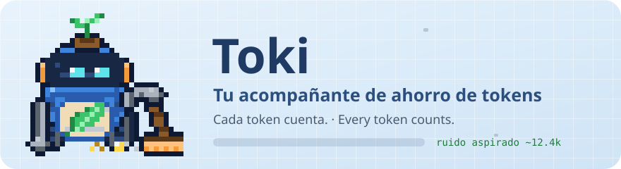

<p align="center">
  
</p>

# Toki: tu acompañante de ahorro de tokens

**Cada token cuenta.** Toki es un robot de limpieza que vive sobre tu prompt en Claude Code: aspira el ruido para que Claude lea solo lo que importa. Lo instalas una vez y se encarga solo: compacta las salidas ruidosas, rescata los errores que se esconden, recuerda lo importante cuando Claude Code compacta, mapea tu proyecto y te avisa justo cuando conviene actuar. Toma las mejores ideas de las herramientas de ahorro más populares, las combina sin que se pisen y nunca sacrifica calidad para ahorrar.

Habla español e inglés. No agrega ni un token fijo a tu contexto.

> Versión 0.6. Requiere Claude Code 2.1.287 o posterior. [English below](#english).

## Instalación

En una sesión de Claude Code:

```
/plugin install toki --marketplace DMercadoCanas/toki
```

Responde `y` para agregar el marketplace y elige el alcance (Enter para "usuario"). Queda activo de inmediato. Desde la terminal del sistema es lo mismo con `claude plugin install toki --marketplace DMercadoCanas/toki`. En la app de escritorio: botón **+** junto al cuadro de texto → **Plugins** → **Add marketplace** con `DMercadoCanas/toki` → **Add plugin**.

## Lo nuevo en 0.9

- **Aviso de caché vencido antes de enviar.** El caché dura 1 hora con una suscripción y 5 minutos en la API. Si vuelves después y la conversación pesa más de 60k tokens, tu próximo mensaje reescribe todo el contexto a precio de escritura, entre 25 y 40 veces lo que cuesta releerlo. Por eso Toki te pregunta antes de enviar y te muestra el costo: con 220k en Opus y una suscripción, «cuenta como ~5 mensajes normales de tu límite»; en la API, «≈$1.06 más que con el caché vivo». Las opciones:
  - **Compactar y enviar:** Toki compacta con su memoria de la tarea y reenvía tu mensaje solo. Después, cada mensaje sale ~30-50% más barato. Desde 120k tokens es la recomendada (★).
  - **Enviar así:** con menos de 120k es la recomendada. Si la eliges dos veces, Toki no vuelve a preguntar en esa sesión.
  - **Empezar en limpio:** Toki hace `/clear` y te devuelve el mensaje al cuadro, con una nota de la tarea, las decisiones y los archivos de antes. Lo revisas y lo envías.
- **Guardia de límites (planes con suscripción).** Toki calcula a tu ritmo de gasto cuándo se acaba la ventana de 5 horas y la semanal. En la de 5 horas usa tu ritmo de los últimos 45 minutos, si lo hay.
  - Si se acaba antes de renovarse, avisa una sola vez por ventana: desde el 50% en la de 5 horas y desde el 30% en la semanal. La barra lo muestra: `5 h 72% se acaba ~3:40 p. m.`.
  - Al 90%, antes de enviar, pregunta una vez: **Modo ahorro hasta que se renueve**, **Seguir igual** o **Esperar**, que deja tu mensaje en el cuadro.
  - En modo ahorro, cada mensaje va con la opción Ahorro sin preguntar: Sonnet si el contexto es chico y menos esfuerzo. `/toki-modelo preguntar` lo quita.
- **Se pueden apagar:** **Avisar si el caché venció** y **Vigilar tus límites**, en la configuración. En `claude -p` y en el SDK nunca preguntan.

## Lo nuevo en 0.8

- **Modelo y esfuerzo para cada mensaje.** Antes de enviar tu mensaje, Toki lo lee y lo clasifica: trivial, normal, complejo o profundo. Usa reglas rápidas y, si duda, una consulta corta a Haiku que dura como máximo 2 segundos. Luego elige el modelo y el esfuerzo de ese mensaje:
  - Un "renombra foo a bar" va con Sonnet y esfuerzo bajo.
  - Un "ultrathink: analiza a fondo…" va con Opus y esfuerzo máximo.
  - Si te trabas ("sigue fallando", "no funciona"), sube un nivel.
- **Te muestra las opciones con sus consecuencias.** Hasta tres opciones, Calidad, Equilibrio y Ahorro, más **Dejar como está**. Cada una muestra su modelo y esfuerzo, cuánto cuesta frente a lo que tienes (`+40%`, `−65%`) y, si cambia el modelo, cuánto caché se reescribe. La recomendada lleva ★.
- **Cuándo pregunta y cuándo cambia solo.** Por defecto pregunta solo si la opción cuesta más o si cambiar el modelo reescribiría más de 30k tokens de caché. Si la opción ahorra, la aplica sola.
- **Te avisa cuando cambia algo.** Si Toki cambia algo, la barra parpadea, suena una campanita y aparece "⚡ Este mensaje va con Sonnet · esfuerzo bajo". El botón **Deshacer** vuelve a lo de antes.
- **Respeta tus decisiones.** Si eliges "Dejar como está", Toki recuerda tu elección para ese tipo de mensaje. Si la eliges 3 veces, deja de preguntar en esa sesión.
- **Cambia entre Opus y Sonnet solo cuando conviene.** Cambiar de modelo obliga a reescribir el caché una vez. Toki solo cambia cuando la conversación es chica o el caché ya está frío (sesión nueva, después de `/clear` o de compactar, o caché vencido). Cambiar el esfuerzo no toca el caché, así que eso lo ajusta siempre.
- **Subagentes con Sonnet.** Si trabajas con Opus, los subagentes de propósito general con encargos sencillos van con Sonnet. Los que tienen su propio modelo (Explore suele usar Haiku) no se tocan.
- **Para comprobar que funciona:** después de cualquier mensaje, `/toki-modelo` muestra la línea «Último mensaje: complejo (…) · Opus · máximo → Opus · alto (−40%) · aplicado», aunque no haya cambiado nada. Mientras un mensaje va con otro modelo o esfuerzo, la barra lo dice: «Opus · alto · por Toki». Y `.claude/toki/diagnostico.txt` guarda una línea `ruta:` por mensaje.
- **`/toki-modelo`** muestra lo que decidió en la sesión y cambia el modo:
  - `preguntar`: el de siempre.
  - `siempre`: pregunta cada vez.
  - `automatico`: nunca pregunta.
  - `no`: apagado.

  También se cambia en la configuración, en **Modelo y esfuerzo por mensaje**.
- **Seguro si algo no calza.** Si tu cuenta no tiene acceso al modelo que Toki eligió y la API responde con otro, Toki lo nota, deja de cambiar el modelo y te avisa. En `claude -p` no puede preguntar: solo aplica los cambios que ahorran.

Medido con `claude -p` y Opus 5.5 de modelo:

| Mensaje | Qué decidió Toki | Resultado |
|---|---|---|
| "renombra la constante foo a bar en utils.js" | trivial → Sonnet, esfuerzo bajo | respondió Sonnet, $0.20 el mensaje |
| "ultrathink: analiza a fondo todos los escenarios…" | profundo → Opus, esfuerzo máximo | respondió Opus con ~16k tokens de razonamiento |

## Lo nuevo en 0.7

- **Compacta antes en modelos de 1M.** Con Opus o Sonnet de 1M, Claude Code espera hasta ~500k (o ~967k, según la cuenta) para compactar, y cada mensaje relee la conversación entera. En una sesión de 128 llamadas que crece hasta ~346k, eso son unos 25M tokens leídos del caché. Toki baja ese umbral a **300k** (puedes elegir 200k, 400k, 500k o dejar el de Claude Code), y su memoria le recuerda la tarea a Claude después de compactar. Si ya elegiste un umbral (`/autocompact` o `CLAUDE_CODE_AUTO_COMPACT_WINDOW`), no lo toca. Probado con sesiones reales: Claude Code lo respeta porque Toki lo pone al arrancar la sesión.
- **Te muestra a dónde se va cada token.** Con las cifras que la API reporta pedido por pedido: cuánto fue releer la conversación, escribir al caché, entrada nueva, respuestas y razonamiento, y subagentes. Si el ahorro va en 0, `/toki-por-que` te dice por qué.
- **Relecturas evitadas.** Lo que Toki saca del contexto (o lo que compacta antes) Claude ya no lo relee en cada pedido siguiente. Toki lo cuenta aparte, pedido por pedido, y descuenta lo que cuesta la compactación misma.
- **Salidas repetidas en una línea.** Si un comando devuelve exactamente lo mismo que hace un rato (`git status`, un build sin cambios), Claude recibe una línea con la ruta de la copia.
- **Modo conciso por tamaño.** Se activa cuando la conversación pasa de ~150k tokens (o la mitad de la ventana de compactación). Antes era al 50% de la ventana, y con 1M de ventana llegaba tarde o nunca.
- **Lo que no hace, a propósito:** Claude Code ya evita releer un archivo que no cambió, así que Toki no lo duplica. Tampoco recorta lo que Claude pidió exacto (`cat`, `sed -n`, `git diff`), para no perder información.

## Lo nuevo en 0.6

- **Se llama Toki** y tiene logo, eslogan y voz propia.
- **Rescate del `| tail`.** Claude suele cortar la salida de los tests con `| tail -n 80`, y el fallo queda en medio, fuera del corte. Toki guarda la salida completa en el camino y le agrega a Claude solo los errores que el corte escondió. En la prueba medida, **la misma tarea gastó la mitad de tokens** y Claude encontró el fallo a la primera.
- **Inglés.** Toki habla el idioma en que le escribes a Claude (o el que elijas).
- **Memoria a prueba de todo.** Si el hook de compactación no puede correr (Windows sin Git Bash) o el guardia de tu empresa lo bloquea, Toki detecta la compactación por su cuenta y le deja la nota a Claude igual.
- **Aviso de cambio de modelo en cuentas de empresa,** donde antes no llegaba el evento.
- **Mantener el caché caliente** (opcional, solo si pagas por token en la API).
- **Rachas y logros:** 🔥 días seguidos ahorrando, medallas, confeti y una fanfarria corta cuando desbloqueas una.
- **PowerShell:** en Windows sin Git Bash, Toki compacta, guarda la copia completa (con `Tee-Object`) y rescata lo que esconde un `| Select-Object -Last`. Probado con la herramienta PowerShell real de Claude Code.
- **Si venías de ahorro-tokens,** la primera vez que arranca Toki trae tu total, tu historial y tu racha.

## Qué hace

| Pieza | Qué hace | Inspirada en |
|---|---|---|
| **Compactador de salidas** | Tests, builds, instalaciones, linters y logs llegan a Claude compactados: agrupa líneas repetidas y parecidas, y conserva cada error, advertencia, el inicio y el final. El original completo queda guardado. | RTK, Token Optimizer |
| **Rescate de errores escondidos** | Claude Code recorta las salidas largas de los comandos que fallan, y justo ahí suele estar el error. Toki copia la salida completa mientras el comando corre y le entrega a Claude el error real, en menos espacio. | Idea propia |
| **Rescate del `\| tail`** | Si Claude corta un test o un build con `\| tail`, Toki le agrega los errores que quedaron fuera del corte, con su contexto. Lo que Claude pidió llega intacto. | Idea propia |
| **Memoria que sobrevive la compactación** | Toki anota la tarea, las decisiones, los archivos editados, los últimos comandos y errores. Cuando Claude Code compacta, se lo recuerda a Claude en una nota corta para que siga donde quedó. | Token Optimizer |
| **Detector de bucles** | Si el mismo comando falla 3 veces seguidas, le pide a Claude cambiar de enfoque antes de seguir reintentando. | Token Optimizer |
| **Mapa del proyecto** | Archivos, símbolos y módulos más usados, sin gastar tokens del modelo. La primera vez que Claude busca algo, le avisa que el mapa existe. | Graphify |
| **Toki, el acompañante** | Un robot de limpieza vivo sobre el prompt que actúa lo que Claude hace, con medidores de contexto, caché, ahorro, racha y límites del plan, y un botón cuando hay algo que hacer. | Token Optimizer |
| **Compactación temprana** | En modelos de 1M, compacta a los 300k en vez de esperar a ~500k-967k: cada mensaje relee menos. La memoria de Toki guarda la tarea. | Idea propia |
| **Cuenta real del gasto** | Lo que costó cada pedido según la API (relectura, caché, entrada, salida, subagentes) y las relecturas que Toki evitó. | Token Optimizer |
| **Salidas repetidas** | La misma salida otra vez llega como una línea con la ruta de la copia. | Token Optimizer |
| **Modelo y esfuerzo por mensaje** | Lee tu mensaje antes de enviarlo y elige el modelo y el esfuerzo que pide la tarea. Si cuesta más, te muestra opciones con su costo; si ahorra, lo aplica y te avisa, con un botón Deshacer. | Model Matchmaker, claude-model-advisor, claude-router |
| **Aviso de caché vencido** | Si el caché venció y la conversación es grande, Toki pregunta antes de enviar, con el costo de cada opción: compactar y enviar, enviar así o empezar en limpio. | Idea propia |
| **Guardia de límites** | Calcula a tu ritmo cuándo se acaban tus límites de 5 h y semanal, y avisa si se acaban antes de renovarse. Al 90 % ofrece el modo ahorro. | Claude-Code-Usage-Monitor, ccusage |
| **Estilo conciso** | Respuestas cortas sin relleno; el código, los errores y las rutas no se tocan. Se activa solo cuando la conversación pasa de ~150k tokens, o con `/output-style`. | Caveman (nivel lite) |

### Reglas que nunca rompe

1. **Cero tokens fijos en el contexto.** No agrega skills ni texto que se cargue en cada mensaje.
2. **No rompe el caché.** Todo lo que agrega va al final; nunca modifica lo que ya se envió. Cambiar de modelo sí lo reescribe. Toki lo hace sin preguntar solo si el caché está frío o la conversación es chica; si no, te muestra cuánto cuesta y decides tú.
3. **Todo es reversible.** La salida original queda en `.claude/toki/salidas/` y Claude la puede leer cuando la necesite.
4. **Nunca provoca reintentos.** Si no está seguro, no toca nada. No compacta lecturas de archivos, diffs ni salidas que Claude ya filtró con `| grep`.
5. **Nunca pide un permiso nuevo.** Solo cambia cómo corre un comando si Claude Code toma la misma decisión de permisos que con el original.
6. **Si algo falla, no estorba.** Claude sigue trabajando normal.
7. **Nada sale de tu computador.** Sin telemetría, sin red.

## La barra de Toki

```
╭──────────────────────────────────────────────────────────────────────────────────────╮
│ [^‿^] ✓ Toki · Listo. En «npm test» te ahorré ~5.4k tokens.                    − × │
│ contexto ██████░░░░░░░░ 37% de 300k · caché ● 48 min · ahorrado ~5.4k · relecturas evitadas ~1.2M · 🔥 4 │
╰──────────────────────────────────────────────────────────────────────────────────────╯
```

- **Toki actúa lo que pasa:** su cara va en la pantalla del robot. `[•_•]···` pensando, `[⊙‿⊙]` leyendo, `[•‿•] ⠋` ejecutando, `✎` editando, `[>‿<] ≋` aspirando (compactando), `[•o•]?` esperando tu permiso, `[^‿^]✓` listo, `\[^‿^]/ ✦` celebrando un logro, `[−_−]zZ` caché frío, `[•△•]!` contexto alto. En la app de escritorio es un dibujo animado: flota, parpadea, gira las ruedas cuando trabaja, aspira con la manguera cuando compacta y lanza confeti con cada logro.
- **Una frase y, si hace falta, un botón:** al 70% de contexto (o si la conversación ya pesa más de 200k tokens) aparece **Compactar ahora** (atajo `c`).
- **Medidores:** contexto (contra el tamaño al que se compacta, no contra el millón del modelo), reloj del caché (`●` lleno → `○` frío), tokens ahorrados en la sesión, relecturas evitadas, tu racha y, en planes con suscripción, los límites de 5 horas y de la semana.
- **Cada ahorro y cada rescate te lo dice** con un aviso corto, y una campanita (solo macOS).
- **`▸ más`** muestra duración, llamadas, salidas compactadas, bucles, cuánto del último turno salió del caché e histórico. **`−`** la deja en una línea. **`×`** la oculta (vuelve con `/toki`).
- **Toki aprende** y lo anota en "Lo que Toki notó": cambios de modelo con el caché caliente, bucles, relecturas del mismo archivo, varias salidas enormes seguidas (mejor un subagente con Haiku), sesiones de más de 3 horas y compactaciones repetidas.

## El panel `/toki`

Cifras grandes (esta sesión, hoy, 7 días, 30 días, histórico), lo que costó la sesión según la API y las relecturas evitadas, a cuánto compacta, tu racha y tus logros, una gráfica del ahorro por día de las últimas dos semanas, qué ocupa tu contexto ahora, los últimos comandos y qué hizo Toki con cada uno, lo que notó en la sesión y sugerencias concretas.

### Logros

✓ Primer ahorro · 10k tokens · 100k tokens · 1M tokens · 3 días seguidos · 7 días seguidos · Memoria a prueba de compactación · Rescate de errores

## Comandos

- **`/toki`**: el panel con todo lo anterior.
- **`/toki-por-que`**: los últimos comandos y, para cada uno, si se compactó (y cuánto ahorró), si se rescató algo o por qué no se tocó. Si crees que Toki no está ahorrando, empieza por aquí.
- **`/toki-modelo`**: qué modelo y esfuerzo eligió para cada mensaje, y el modo (`preguntar`, `siempre`, `automatico`, `no`).
- **`/toki-mapa`**: crea o actualiza el mapa del proyecto (también se crea solo, una vez al día, en repositorios git).
- **`/output-style`** → `toki:conciso`: respuestas cortas desde ya.

## Configuración

En `/plugin`, elige Toki y abre su configuración. Puedes apagar cualquier pieza (compactador, salidas repetidas, mapa automático, acompañante, sonidos, memoria, modo conciso), fijar el idioma, elegir **Compactar a los…** (200k, 300k, 400k, 500k o "no" para dejar el de Claude Code; el cambio vale desde la próxima sesión) y activar **Mantener el caché caliente**:

- Solo sirve si pagas por token en la API, donde el caché dura 5 minutos. Con una suscripción el caché normalmente dura una hora y Toki no hace nada.
- Mientras lees o piensas, Toki hace un "ping" que solo lee el caché cada ~4 minutos, como máximo 30 minutos después de tu último mensaje. Cada ping cuesta ~10% del precio normal de tu contexto; volver con el caché frío cuesta ~125%.
- Se detiene solo si el caché ya se enfrió, si cambias de modelo o si no hay nada que mantener. Viene apagado.

## Resultados medidos (con y sin Toki)

Misma pregunta, mismo modelo (Haiku), dos corridas por escenario, tokens de entrada totales que reporta Claude Code (incluye caché):

| Escenario | Sin Toki | Con Toki | Diferencia |
|---|---|---|---|
| "Corre npm test y dime qué test falla": Claude corta la salida con `\| tail` y el fallo queda en medio | 184.6k–192.6k tokens · 3 comandos | 93.1k tokens · 1 comando | **−50% y dos comandos menos** |
| "Corre npm run enorme y dime qué error aparece al final": 1,6 MB de salida con el error en la última línea | 134.2k–179.9k tokens · 3–4 turnos | 88.1k tokens · 2 turnos | **−34% a −51%** |
| PowerShell: "Corre npm test y dime qué test falla" (Claude Code recorta la salida del fallo por el medio) | 154.7k–208.0k tokens · 4 turnos | 97.1k–97.2k tokens · 2 turnos | **−37% a −53%** |
| PowerShell: `npm test \| Select-Object -Last 30` | ~96k tokens, y Claude **no pudo decir** qué test fallaba | ~96k tokens, respuesta correcta a la primera | misma cifra, la respuesta cambia |
| `npm test` con 1 fallo entre 421 tests (26 KB de salida, sin filtrar) | 94.5k tokens · 2 turnos | 89.8k–94.5k tokens · 2 turnos | hasta −5% |

Lo honesto: el ahorro grande aparece cuando Toki le evita a Claude volver a correr o volver a buscar. En una sesión real larga, cada llamada que se evita vale mucho más que aquí, porque reenvía toda la conversación.

Las **relecturas evitadas** son otra cuenta, aparte: lo que Toki sacó del contexto, multiplicado por cada pedido siguiente que ya no lo releyó, hasta la próxima compactación. Si Toki compactó antes que Claude Code, cuenta la diferencia de tamaño en cada pedido mientras la conversación "sin Toki" no hubiera llegado al umbral de Claude Code, y descuenta una lectura completa por la compactación. Son lecturas de caché: la parte más barata de cada pedido, pero la más grande.

Lo que la barra muestra como "ahorrado" es la diferencia entre lo que Claude habría leído sin Toki (como máximo 30 KB, o la vista previa de 2 KB cuando Claude Code guarda la salida en un archivo) y lo que leyó con él, a ~4 caracteres por token. Es una estimación conservadora y siempre lleva "~": los rescates y los turnos evitados no se suman.

En `evals/` hay una suite para `claude plugin eval`, que corre cada caso con y sin el plugin y califica el resultado (necesita el sandbox del sistema; en macOS viene incluido).

## Límites conocidos

- La copia completa y los rescates funcionan con bash y zsh (macOS, Linux, WSL, Git Bash) y con PowerShell. PowerShell está probado con la herramienta real de Claude Code y PowerShell 7; con Windows PowerShell 5.1 (que guarda la copia en UTF-16) solo con pruebas automáticas. Si ves algo raro, `/toki-por-que` lo explica y puedes apagar el compactador en la configuración.
- Toki solo envuelve un comando si Claude Code le da exactamente el mismo permiso que al original. Si tienes reglas finas (por ejemplo `Bash(npm test:*)`), el comando envuelto ya no calza con la regla, así que Toki compacta lo que entrega Claude Code sin copia completa, y lo dice en el encabezado si Claude Code ya había recortado algo.
- En cuentas de empresa (Team o Enterprise), Claude Code carga un guardia que no deja a los plugins intervenir en la compactación ni recibir el evento de cambio de modelo. Toki lo compensa: detecta ambas cosas por su cuenta.
- La franja se dibuja en la terminal y en la app de escritorio. En la extensión de VS Code y en `claude -p` el motor funciona igual, sin franja; `/toki` responde con el reporte en texto.
- El mapa es análisis de texto, no un árbol sintáctico completo: puede omitir símbolos en código poco convencional.

## English

**Toki: your token-saving companion. Every token counts.**

Toki is a little cleaning robot that lives above your Claude Code prompt and vacuums up the noise so Claude reads only what matters. Install it once and it takes care of the rest: on 1M-context models it compacts at 300k instead of waiting until ~500k–967k (every message re-reads the whole conversation), it shows what each request really cost according to the API, it collapses identical repeated outputs into one line, it compacts noisy command output (tests, builds, installs, linters, logs) while keeping every error, rescues the errors Claude Code's truncation or a `| tail` would hide, reminds Claude of the task after a compaction, maps your project without using the model, and tells you when it is the right moment to compact or clear. It adds zero always-on tokens to your context and never touches file reads or diffs.

```
/plugin install toki --marketplace DMercadoCanas/toki
```

- Toki speaks the language you write to Claude in. You can pin it to `en` or `es` in its settings.
- `/toki` opens the panel: savings for this session, today, 7 and 30 days, your 🔥 streak, achievements, a 14-day chart, what fills your context, and suggestions.
- `/toki-por-que` explains, command by command, what Toki did and why, and where the session's tokens went when savings are ~0.
- **Model and effort per message (0.8).** Before each message is sent, Toki reads it and picks a model and effort: Sonnet on low effort for a rename, Opus on max for "ultrathink". When the pick saves, Toki applies it and shows a notice with **Undo**. When it costs more, or switching models would rewrite more than 30k tokens of cache, Toki asks first and shows each option's cost (`+40%`, `−65%`). Toki only switches between Opus and Sonnet while the context is small or the cache is already cold; effort changes keep the cache. Simple general-purpose subagents run on Sonnet. `/toki-modelo preguntar|siempre|automatico|no` sets how it behaves.
- **Before you send (0.9).** If the cache expired (1 h on a subscription, 5 min on the API) and the conversation is over 60k tokens, Toki asks first and shows the cost, in normal messages or in dollars. You can compact and send (Toki resends your message), send as is, or start fresh: `/clear`, with your message put back in the box with a note of the task. On a subscription, Toki projects when your 5-hour and weekly limits run out at your current pace. It warns once if a limit runs out before it resets. At 90% it offers a saving mode until the reset.
- Settings: **Compact at…** (200k, 300k, 400k, 500k, or "no" to keep Claude Code's); if you already chose a window, Toki leaves it alone.
- Measured with Haiku: when Claude cuts test output with `| tail` and the failure sits in the middle, the same task used **half the tokens** with Toki (93.1k vs 184.6k–192.6k) and needed one command instead of three. With a 1.6 MB output, 88.1k vs 134.2k–179.9k.
- Optional for API (pay-per-token) users: keep the 5-minute prompt cache warm while you read or think, at ~10% of the cost of reprocessing.

## Para desarrollar

```
claude plugin validate .
claude plugin test .
claude --plugin-dir .
```

La lógica pura vive en `hooks/` (`compresor.ts`, `gasto.ts`, `cache.ts`, `bucles.ts`, `mapa.ts`, `mascota.ts`, `toki-svg.ts`, `historial.ts`, `memoria.ts`, `idioma.ts`); `hooks/register.tsx` la conecta con Claude Code. Las pruebas están en `tests/`. Los sonidos de `sonidos/` son sintéticos (generados con Python, sin derechos de terceros).

## Créditos

Toki se inspira en las ideas de otros, reimplementadas desde cero:

- [Caveman](https://github.com/JuliusBrussee/caveman), de Julius Brussee: respuestas concisas.
- [RTK](https://github.com/rtk-ai/rtk), de rtk-ai: filtros de salida por familia de comandos.
- [Graphify](https://github.com/safishamsi/graphify), de Safi Shamsi: el mapa del proyecto sin usar el modelo.
- [Token Optimizer](https://github.com/alexgreensh/token-optimizer), de Alex Greenshpun: archivar originales, detectar bucles y el acompañante en la interfaz.
- [Model Matchmaker](https://github.com/jacobcxdev/model-matchmaker), de jacobcxdev, [claude-model-advisor](https://github.com/mmediavilla/claude-model-advisor), de mmediavilla, [claude-router](https://github.com/alexei-led/claude-router), de alexei-led, y [claude-model-router](https://github.com/TFoxik/claude-model-router), de TFoxik: clasificar el mensaje sin gastar tokens, mostrar cuánto cuesta reescribir el caché y cambiar de modelo solo cuando compensa.
- [Claude-Code-Usage-Monitor](https://github.com/Maciek-roboblog/Claude-Code-Usage-Monitor), de Maciek-roboblog, y [ccusage](https://github.com/ryoppippi/ccusage), de ryoppippi: proyectar a tu ritmo cuándo se acaba el límite.

## Licencia

MIT
